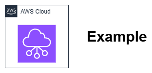

# 컨벤션 {#conventions}

이 섹션에서는 본 모범 사례 가이드에서 사용되는 여러 컨벤션을 설명합니다.

## 아키텍처 다이어그램 {#architecture-diagrams}

### AWS 아키텍처 아이콘 {#aws-architecture-icons}

아키텍처 다이어그램에는 [최신 AWS 아키텍처 아이콘 세트](https://aws.amazon.com/architecture/icons/)를 사용하세요. 아이콘은 실제로 나타내는 대상에만 사용합니다.

### 형식 및 도구 {#format-and-tooling}

아키텍처 다이어그램은 흰색과 같은 밝고 중립적인 배경의 PNG 파일 형식으로 제공하세요. 모든 요소 주위에 8px의 여백을 남겨두세요. 각 다이어그램에는 향후 수정이 가능하도록 [draw.io](https://www.drawio.com/) 형식의 소스 파일을 함께 제공해야 합니다.

#### 파일 구성 {#file-organization}

다음 구조를 사용하여 파일을 저장하세요:

```
content/
  assets/
    foundation/
      vpc-setup-diagram.png
      vpc-setup-diagram.drawio
    security/
      network-acl-flow.png
      network-acl-flow.drawio
```

#### 기술 요구 사항 {#technical-requirements}

* **파일 형식**: 투명 배경의 PNG
* **크기**: 최대 너비 1200px, 가로세로 비율 유지. 다이어그램은 700px 너비로 축소했을 때도 읽을 수 있어야 합니다.
* **파일 크기**: 최적의 로딩 속도를 위해 500KB 미만으로 유지
* **해상도**: 웹 표시를 위해 72~96 DPI

#### 라이트 및 다크 모드 호환성 {#light-and-dark-mode-compatibility}

다이어그램은 라이트 및 다크 색상 테마 모두에서 사용할 수 있어야 합니다. 이를 위해 다음을 따르세요:

* **투명 배경 사용** — 흰색 배경은 사용하지 마세요. 투명 배경을 사용하면 다이어그램이 두 가지 색상 테마에 모두 적응할 수 있습니다.
* **투명 배경 위의 텍스트와 선에는 `#7E7E7E` 사용** — 검정(`#000000`)이나 흰색(`#FFFFFF`)은 사용하지 마세요. 이 회색은 라이트 배경(`#FFFFFF`)과 다크 배경(`#1e1e1e`) 모두에 대해 거의 동일한 대비를 제공합니다.
* **색상이 채워진 노드 내부의 텍스트**(배경색이 있는 경우)는 흰색 또는 노드의 채우기 색상에 적합한 다른 색상을 사용할 수 있습니다. `#7E7E7E` 규칙은 투명 배경 위에 직접 위치하는 요소에만 적용됩니다.

!!! note "대비율 제한 사항"
    `#7E7E7E` 회색은 라이트 및 다크 배경 모두에 대해 약 4.1:1의 대비율을 달성합니다. 이는 WCAG AA 최소 기준인 4.5:1보다 약간 낮습니다. 이는 허용된 트레이드오프입니다. 흰색과 거의 검정에 가까운 배경 모두에 대해 4.5:1 대비율을 동시에 달성할 수 있는 단일 색상은 존재하지 않습니다(해당 범위는 수학적으로 상호 배타적입니다). `#7E7E7E` 중간값은 이미지 파일을 중복 제공하지 않고도 두 테마 모두에서 최상의 균형 잡힌 가독성을 제공합니다.

{ width="300" }
/// caption
예시 이미지 캡션 - [Drawio 소스](../assets/community/Example.drawio)
///

### 접근성 {#accessibility}

접근성을 고려하여 아키텍처 다이어그램을 작성하세요. 텍스트(또는 선)와 배경의 대비율은 [최소 4.5:1](https://www.w3.org/WAI/WCAG21/Understanding/contrast-minimum.html) 이상이어야 합니다. 일반적으로 강한 대비 배경 위의 흰색 또는 검정색이 가장 좋은 선택입니다.

#### 접근성 예시 {#accessibility-examples}

**좋은 대비 조합:**

* 흰색 배경(#FFFFFF)에 검정 텍스트(#000000) - 21:1 비율
* 흰색 배경에 짙은 회색 텍스트(#16191F) - 12.6:1 비율

**나쁜 대비 조합:**

* 흰색 배경에 밝은 회색 텍스트(#CCCCCC) - 1.6:1 비율 ❌
* 흰색 배경에 노란색 텍스트 - 1.1:1 비율 ❌

#### 가이드라인 {#guidelines}

* **단순하게 유지**: 가능한 한 단순한 다이어그램을 작성하세요. 필요하다면 여러 다이어그램으로 내용을 나누세요. 냅킨에 스케치할 수 없다면 너무 복잡한 것입니다.

* **이중 인코딩 사용**: 색상만을 차이의 유일한 지표로 사용하지 마세요.

* **대체 텍스트를 신중하게 사용**: 시각적 요소에 내용을 간략히 설명하는 대체 텍스트를 포함하세요.

### 다이어그램 스타일링 {#diagram-styling}

다음 가이드를 참고하여 다이어그램의 스타일을 AWS의 시각적 스타일 및 언어와 일치시키세요. 다이어그램이 아래의 모든 요소 가이드라인을 충족하는지 확인하세요.

* **배경색**: 배경색으로 흰색(#FFFFFF)을 사용하세요. 배경을 투명하게 두지 마세요.

* **선과 화살표**: 선의 최소 두께/너비는 1pt 이상이어야 합니다. 주요 연결 및 컨테이너에는 실선을 사용하세요. 보조 연결 및 컨테이너는 점선으로 표현할 수 있습니다. 화살표 포인터 스타일은 닫힌 화살표보다 열린 화살표를 사용하세요.

* **색상**: 공식 아이콘 라이브러리에서 제공하는 색상은 수정하지 마세요. 색상에는 의미가 담겨 있으므로(예: 특정 색상은 서비스 카테고리를 나타냄) 그대로 사용하세요. 다이어그램에 추가 색상이 필요한 경우, 해당 색상 값이 [AWS 브랜드 색상 팔레트](https://design.amazon.com/styleguide/9188F3F120Af/aws/visual-identity/color/)에 포함되어 있는지 확인하세요.

* **타이포그래피(폰트)**: 대부분의 경우 Regular 굵기를 사용하세요. 추가적인 강조가 필요한 경우 Bold를 사용할 수 있습니다. Thin이나 Light는 사용하지 마세요(대부분의 다이어그램에서 필요한 폰트 크기 이하에서 접근성 기준을 충족하지 못합니다). 최소 폰트 크기는 12px이어야 합니다. 대부분의 아이콘/일러스트레이션 레이블에는 #16191F 또는 #000000 색상을 사용하세요. 다이어그램에서는 ^^밑줄^^보다 *기울임꼴*을 권장합니다. (화살표/선이 있는 다이어그램에서 밑줄은 불필요한 시각적 노이즈를 추가할 수 있습니다.)

* **레이블과 텍스트**: 레이블을 아이콘과 가운데 정렬하고 아이콘 아래에 배치하세요. 설명 텍스트를 이미지에 직접 삽입하지 마세요. 접근성과 현지화가 불가능합니다. 각 설명 개체나 아이콘에는 짧은 레이블만 사용하세요. 다이어그램의 특정 부분을 설명 텍스트로 강조하고 싶다면 콜아웃을 사용하세요. 이는 접근성, 현지화 및 지역 규정 준수에 더 적합합니다.

* **외부 프레임**: 이미지의 상하좌우에 동일하게 8px의 패딩을 적용하세요. 다이어그램에 눈에 보이는 외부 테두리를 적용하지 마세요. 테두리 그림자와 페이드 효과도 사용하지 않을 것을 권장합니다.

## IP 주소 표현 {#representing-ip-addresses}

실제 네트워크와의 충돌을 방지하고 예시가 보편적으로 동작하도록 승인된 문서용 범위를 사용하세요. 자동화된 유효성 검사가 이 기준을 적용합니다.

### 예시 IP 범위 및 주소 {#example-ip-ranges-and-addresses}

"공인" IP 주소를 문서화할 때는 IPv4 및 IPv6 주소에 대해 사용 가능한 여러 [문서용 범위](https://en.wikipedia.org/wiki/Reserved_IP_addresses) 중 하나를 사용하세요. IPv4 범위의 경우 ```192.0.2.0/24```, IPv6 범위의 경우 ```2001:db8::/32```가 좋은 예입니다.

"내부 범위" 예시에는 VPC 내에서 모두 지원되는 [RFC1918](https://datatracker.ietf.org/doc/html/rfc1918) (```10.0.0.0/8, 172.16.0.0/12, 192.168.0.0/16```), [RFC6598](https://datatracker.ietf.org/doc/html/rfc6598) (```100.64.0.0/10```), 또는 [RFC6815](https://datatracker.ietf.org/doc/html/rfc6815) 공간 (```198.19.0.0/16```)을 사용하세요.

#### 전체 네트워크 예시 {#complete-network-examples}

**다중 계층 VPC 구성:**

```
VPC: 10.0.0.0/16
  Public subnet: 10.0.1.0/24
  Private subnet: 10.0.2.0/24
  Database subnet: 10.0.3.0/24
```

### IPv6 주소 및 네트워크 표현 {#representing-ipv6-addresses-and-networks}

IPv6 주소를 표현할 때는 [RFC5952](https://datatracker.ietf.org/doc/html/rfc5952)를 준수하세요.

| <!-- --> | 예시 |
| -------- | -------- |
| :material-check:{ style="color: #4DB6AC" } **올바름** | ```2001:db8:0:1234::``` |
| :material-close:{ style="color: #EF5350" } **잘못됨** | ```2001:0db8:0000:1234::``` |
| :material-close:{ style="color: #EF5350" } **잘못됨** | ```2001:DB8:0:1234::``` |
| :material-close:{ style="color: #EF5350" } **잘못됨** | ```2001:0DB8:0000:1234::``` |

## 콘솔 스크린샷 {#console-screenshots}

AWS 콘솔은 자주 변경되며, 한 섹션 내 여러 스크린샷 간에 일관된 모습을 유지하면서 이미지를 업데이트하기가 어렵습니다. 또한 고객은 AWS 배포 자동화에 투자하고, 콘솔은 검토·모니터링·테스트 용도로만 사용해야 합니다. 따라서 다음과 같은 경우에는 스크린샷 사용을 피해야 합니다.

* 서비스 구성 방법
* 기본적인 AWS 작업

다음과 같은 경우에는 사용 여부를 신중하게 검토하세요.

* 콘솔에서 그래픽 출력(지도, 차트 등)을 보여줄 때
* 콘솔에서 특정 기능이나 항목을 강조할 때, 특히 위치를 글로 설명하기 복잡한 경우

## 빠른 체크리스트 {#quick-checklist}

다이어그램 제출 전 확인 사항:

* [ ] 최신 AWS 아키텍처 아이콘 사용
* [ ] 흰색 배경의 PNG 형식
* [ ] 매칭되는 .drawio 소스 파일 포함
* [ ] 텍스트 명암비 ≥ 4.5:1
* [ ] 글꼴 크기 ≥ 12px
* [ ] 승인된 IP 범위 사용
* [ ] 파일 크기 < 500KB
* [ ] 설명적인 대체 텍스트 포함

## 생성형 AI 사용 {#use-of-generative-ai}

생성형 AI 도구(Amazon Q, Claude, ChatGPT, GitHub Copilot 등)는 텍스트 콘텐츠 작성 및 이미지·다이어그램 생성에 활용할 수 있습니다. AI가 보조한 콘텐츠도 사람이 작성한 콘텐츠와 동일한 품질 기준을 충족해야 하며, 콘텐츠 생성 방식에 관계없이 프로젝트의 [철학](philosophy.md)과 이 페이지의 컨벤션이 동일하게 적용됩니다.

**AI 생성 콘텐츠 요구 사항:**

* **사람의 검토는 필수입니다.** AI가 생성한 모든 텍스트와 이미지는 풀 리퀘스트를 생성하기 전에 기여자가 기술적 정확성, 어조, 프로젝트 컨벤션 준수 여부를 직접 검토해야 합니다. AI 출력물은 초안이지 완성된 결과물이 아닙니다.
* **기술적 정확성은 검토자의 책임입니다.** AI 도구는 사실과 다르거나, 오래되었거나, 미묘하게 오해를 유발하는 내용을 그럴듯하게 생성할 수 있습니다. 검토자는 서비스 기능, 요금 세부 정보, API 동작, 아키텍처 권장 사항을 최신 AWS 문서와 대조하여 반드시 확인해야 합니다.
* **콘텐츠 본문에 AI 사용 여부를 공개하지 마십시오.** 독자는 콘텐츠가 사람이 작성했는지 AI의 도움을 받았는지 알 수 없어야 합니다. 어느 경우든 품질 기준은 동일합니다.
* **AI 도구를 위한 가이드 컨벤션이 존재합니다.** 이 프로젝트에는 저장소에서 작업하는 AI 도구에 구조 및 형식 지침을 제공하는 `.kiro/steering/content-conventions.md` 파일이 포함되어 있습니다. AI 도구를 사용하는 기여자는 일관된 출력을 위해 해당 파일을 도구가 인식하도록 설정해야 합니다. 해당 파일의 콘텐츠 규칙은 사람 기여자에게도 동일하게 적용되며, 이 페이지와 [철학](philosophy.md)이 공개 버전입니다.
* **AI가 생성한 이미지도 동일한 기준을 충족해야 합니다.** AI가 생성한 다이어그램은 승인된 AWS 아키텍처 아이콘을 사용하고, 접근성 명암 대비 요구 사항을 충족하며, 향후 편집을 위한 `.drawio` 소스 파일을 포함해야 합니다. 이는 사람이 직접 만든 다이어그램과 동일한 기준입니다.

## 변경 이력 {#changelog}

[변경 이력](../changelog.md)은 독자의 의사 결정에 영향을 미치는 콘텐츠 변경 사항을 기록합니다. 변경 이력 페이지는 다른 콘텐츠 페이지에 적용되는 페이지 구조 규칙에서 면제됩니다. 즉, 사전 요구 사항 admonition, 다이어그램, 도입부 단락 요건, 모범 사례 섹션, 관련 페이지 섹션이 필요하지 않습니다. 그 외 나머지 컨벤션은 동일하게 따르며, AWS 서비스 명칭, 라틴어 약어 금지, 특정 가격 정보 금지 규칙을 포함한 동일한 유효성 검사를 통과해야 합니다.

**포함 기준:** 이전 버전의 페이지를 적용한 독자가 지금과 다른 결정을 내렸을 경우, 해당 항목은 변경 이력에 포함됩니다. 오탈자 및 문법 수정, 깨진 링크 수정, 린트 또는 포맷 변경, CI 및 GitHub Actions 변경, SEO 및 사이트 메타데이터, 풀 리퀘스트 내 리뷰 피드백 반영, 의미 변경이 없는 이미지 또는 아이콘 수정은 기록하지 않습니다. 항목의 단위는 커밋이 아닌 병합된 풀 리퀘스트입니다.

각 항목은 고정된 아이콘과 함께 네 가지 변경 유형 중 하나를 사용합니다. 각 유형은 하나의 GitHub 레이블에 매핑됩니다.

| 아이콘 | 유형 | 레이블 | 사용 시점 |
| ---- | ---- | ----- | -------- |
| 🆕 | 신규 가이던스 | `changelog:new` | 새로운 모범 사례, 섹션, 또는 서비스 기능이 문서화된 경우 |
| 🔄 | 권장 사항 변경 | `changelog:changed` | 이전과 다른 조언 또는 기본 선택이 제시된 경우 |
| 🔧 | 수정 | `changelog:correction` | 독자의 행동에 영향을 미치는 방식으로 사실적, 기술적, 또는 다이어그램 오류가 수정된 경우 |
| 🗑️ | 제거됨 | `changelog:removed` | 가이던스, 권장 사항, 또는 섹션이 폐기된 경우 |

레이블이 유형의 기준입니다. `changelog:*` 레이블이 정확히 하나인 풀 리퀘스트는 해당 유형으로 변경 이력에 포함되며, 레이블이 없는 풀 리퀘스트는 게시되지 않습니다. 메인테이너는 레이블을 교체하여 잘못된 유형을 수정하므로, 풀 리퀘스트 설명을 별도로 편집할 필요가 없습니다.

항목은 풀 리퀘스트가 병합된 월을 기준으로 최신순으로 그룹화되며, 다음 형식을 따릅니다.

```markdown
* 🔄 **Changed recommendation** — [Page title](path/to/page.md#anchor): Previously X. Now Y. ([#123](https://github.com/aws/aws-networking-best-practices/pull/123))
```

* **실제 앵커로 링크하세요.** 변경이 발생한 페이지로 링크하고, 가능한 경우 변경 사항이 포함된 제목으로도 링크하세요.
* **🔄 및 🗑️의 경우 양쪽 내용을 모두 기술하세요.** "Previously X. Now Y." 형식으로 작성하여, 독자 또는 오래된 학습 데이터를 가진 AI 모델이 더 이상 적용되지 않는 내용을 확인할 수 있도록 하세요.
* **한두 문장으로 간결하게 작성하세요.** 무엇이 변경되었는지, 그리고 의사 결정에 왜 중요한지를 설명하세요.

풀 리퀘스트 작성자는 풀 리퀘스트 템플릿의 "Changelog entry" 섹션에 제안된 유형을 포함하여 항목을 제안합니다. 메인테이너는 최종 유형을 결정하는 `changelog:*` 레이블을 적용하며, `scripts/generate-changelog.sh` 스크립트가 레이블이 지정된 항목의 형식을 자동으로 생성합니다. 작성자가 제안한 유형과 레이블이 일치하지 않을 경우, 레이블이 우선하며 스크립트는 경고를 출력합니다. 전체 흐름은 [변경 이력 항목](making-a-pull-request.md#changelog-entries)을 참조하세요.

## 가격 참조 {#pricing-references}

네트워킹 서비스 및 아키텍처 결정의 비용 영향을 논의할 때:

* **구체적인 금액이 아닌 가격 책정 기준을 참조하세요.** AWS 가격은 리전마다 다르며 자주 변경됩니다. 청구 대상(*시간당*, *GB당 처리*, *어태치먼트당*, *요청당*)과 서비스 간 상대적 비교를 설명하되, 구체적인 가격(예: "$0.045/GB")은 포함하지 마세요.
* **상대적 비교를 활용하세요.** "VPC 피어링은 데이터 처리 요금이 없는 반면 Transit Gateway는 GB당 요금이 부과됩니다" 또는 "DNS Firewall은 동일한 트래픽 볼륨에 대해 Network Firewall보다 훨씬 저렴합니다"와 같은 표현은 리전과 시간이 지나도 유효하고 정확합니다.
* **공식 가격 페이지로 링크를 제공하세요.** 비용이 의사 결정 요소인 경우, 독자가 해당 리전의 최신 가격을 확인할 수 있도록 관련 AWS 가격 페이지 링크를 포함하세요.

## 할당량 및 절차 참조 {#quota-and-procedure-references}

서비스 할당량 또는 제한이 설계를 제약하거나, 권장 사항에 서비스 구성이 포함되는 경우:

* **값이 아닌 차원을 명시합니다.** 할당량과 제한은 자주 변경되며 리전 및 계정에 따라 다릅니다. 무엇이 제약되는지(예: 터널당 처리량 또는 어태치먼트당 경로), 초과 시 무엇이 중단되는지, 그리고 어떤 설계 결정을 유도하는지를 설명합니다. 조정 가능 여부와 관계없이 수치 용량 또는 개수 할당량은 명시하지 않습니다.
* **설계가 의존하는 구성 값은 명시합니다.** 패킷 크기(MTU, MSS, 캡슐화 오버헤드) 및 포트 번호와 같은 프로토콜 상수는 해당 값을 정의하는 페이지 링크와 함께 명시할 수 있습니다.
* **현재 할당량 페이지에 링크를 제공합니다.** 독자가 자신의 리전 및 계정에 적용되는 값을 직접 확인할 수 있습니다.
* **절차가 아닌 결정 사항을 설명합니다.** 무엇을 구축할지, 그 이유, 그리고 그렇지 않을 경우 무엇이 중단되는지를 설명합니다. 단계별 콘솔, CLI 및 구성 지침은 AWS 공식 문서에서 다룹니다.
