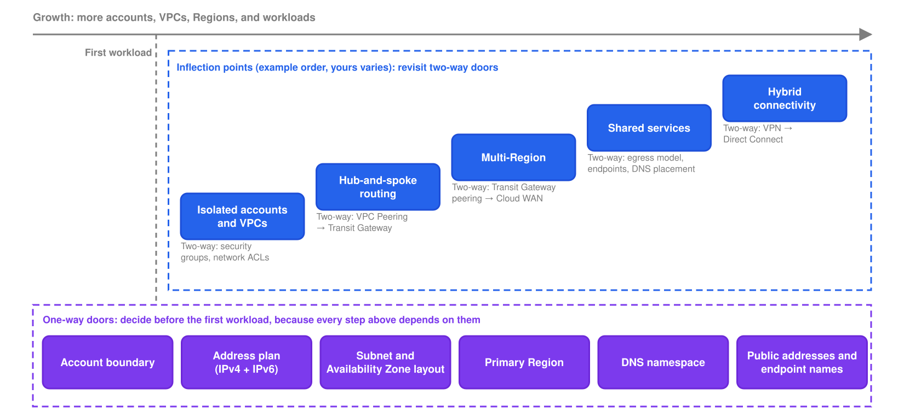

# 의사결정 프레임워크: 단방향 문과 양방향 문 {#decision-framework-one-way-and-two-way-doors}

!!! info "사전 요구 사항"
    이 페이지는 [소개](index.md)의 다섯 가지 기둥과 [AWS Organizations](foundation/organizations.md)의 멀티 계정 모델에 대한 이해를 전제로 합니다. 이 가이드가 처음이라면 해당 내용을 먼저 검토하세요.

네트워킹 결정은 이를 되돌리기 위해 해당 결정에 의존하는 워크로드를 재구축하거나 마이그레이션해야 한다면 **단방향 문(one-way door)**이고, 구성 변경만으로 되돌릴 수 있다면 **양방향 문(two-way door)**입니다. AWS 네트워킹에서 VPC의 기본 CIDR 블록, 계정 경계, 서브넷 및 가용 영역 배치, IPv6 주소 계획, 그리고 다른 당사자가 의존하는 퍼블릭 주소는 단방향 문에 해당합니다. VPC 피어링, AWS Transit Gateway, AWS Cloud WAN 간의 선택은 양방향 문입니다. 세 가지를 마이그레이션 중에 나란히 운영할 수 있기 때문입니다.

잘못된 네트워크 결정의 비용은 수정 자체에 있는 경우가 드뭅니다. 네트워크 위에 구축된 모든 워크로드는 해당 네트워크의 주소 계획, 계정 경계, 서브넷 레이아웃을 그대로 물려받습니다. 따라서 되돌리는 데 드는 비용은 의존하는 워크로드가 늘어날수록 함께 증가합니다. 첫 번째 워크로드 이전에는 쉽게 변경할 수 있는 문이라도, 수백 개의 워크로드가 의존하게 된 이후에는 사실상 단방향 문이 될 수 있습니다. 이를 다루는 두 가지 도구가 있습니다. **문 유형(door type)**은 결정을 되돌리기가 얼마나 어려운지를 묻고, **변곡점(inflection points)**은 현재 설계가 더 이상 맞지 않게 되는 시점을 식별합니다.

이 페이지는 설계 가이드가 아닌 레지스트리입니다. 결정을 단방향 문 또는 양방향 문으로 분류하고, 해당 문을 다시 여는 트리거를 명시하며, 각 결정의 세부 내용을 다루는 페이지로 연결합니다. 문 용어는 [Amazon의 2015년 주주 서한](https://www.sec.gov/Archives/edgar/data/1018724/000119312516530910/d168744dex991.htm)에서 가져온 것으로, 신중한 검토가 필요한 되돌리기 어려운 결정과 신속하게 내려야 할 가역적 결정을 구분합니다.

/// caption
의사결정 프레임워크 개요 — [Drawio 소스](assets/decision-framework/decision-framework-overview.drawio)
///

## 결합 규칙 {#the-combined-rule}

문 유형은 결정 시점을 결정하고, 변곡점은 재검토 시점을 결정합니다.

| 문 유형 | 결정 시점 | 재검토 시점 | 되돌리기 시 수반되는 작업 |
| --- | --- | --- | --- |
| **단방향** | 첫 번째 워크로드 이전, 플랫폼·보안·네트워크 소유자의 의견을 반영하여 결정 | 각 변곡점 이전, 해당 결정이 다음 전환을 여전히 지원하는지 확인 | 종속 워크로드 재구축 또는 마이그레이션, 혹은 통제할 수 없는 당사자와의 조율 |
| **양방향** | 트리거 시점에 결정하되, 그 이전에는 결정하지 않음. 현재 상황에 맞는 가장 단순한 설계 선택 | 각 변곡점마다 | 구성 변경, 병렬 실행, 또는 단계적 마이그레이션 |

***핵심 인사이트:*** *변곡점은 단방향 문 결정을 미루는 이유가 되지 않습니다. 각 전환은 이전에 내려진 단방향 결정에 의존하므로, 단일 리전에서 여러 리전으로 확장하는 설계라면 두 번째 리전이 생기기 전에 리전별 주소 블록과 DNS 계층 구조가 미리 설정되어 있어야 합니다.*

### 문 유형은 시간이 지남에 따라 변합니다 {#doors-change-type-over-time}

결정을 내릴 때 분류하고, 종속 항목이 누적됨에 따라 재분류하십시오. 워크로드가 없는 VPC CIDR 블록은 양방향 문입니다. VPC를 삭제하고 다시 생성할 수 있기 때문입니다. 그러나 수백 개의 워크로드, 피어링 연결, 방화벽 규칙, 그리고 해당 블록을 참조하는 온프레미스 경로가 생기면 동일한 결정이 단방향 문이 됩니다. 이것이 바로 아래 레지스터에서 각 단방향 문이 되돌리기 어렵다는 사실만 명시하는 것이 아니라, 언제 결정해야 하는지를 함께 명시하는 이유입니다.

## 되돌리기 어려운 결정 {#one-way-doors}

| 결정 | 되돌리기 위해 필요한 작업 | 결정 시점 | IPv4 및 IPv6 | 자세히 알아보기 |
| --- | --- | --- | --- | --- |
| **VPC 기본 CIDR 블록** | 기본 CIDR 블록은 제거할 수 없으며, 기존 CIDR 블록의 크기를 조정할 수 없습니다. 보조 CIDR 블록은 추가 및 제거가 가능하지만, 추가할 때마다 라우팅 항목과 서비스별 제한이 생깁니다. 되돌리려면 새 VPC를 생성하고 워크로드를 마이그레이션해야 합니다. | 각 리전의 첫 번째 VPC 생성 전 | 기본 블록은 IPv4입니다. IPv6 CIDR 블록은 별도로 연결됩니다. | [CIDR 계획](foundation/cidr.md#start-with-16-for-production-vpcs), [VPC CIDR 블록](https://docs.aws.amazon.com/vpc/latest/userguide/vpc-cidr-blocks.html) |
| **주소 계층 구조 및 중복 없는 주소 공간** | 범위가 겹치면 네트워크 간 네이티브 라우팅이 불가능하고 VPC 피어링이 완전히 차단됩니다. 복구 방법(IP 재할당, AWS PrivateLink 또는 Amazon VPC Lattice를 통한 서비스 노출, 관리형 1:1 NAT)은 각각 비용이나 주소 관리 부담을 추가합니다. | 첫 번째 VPC를 할당하기 전, 그리고 온프레미스 또는 다른 클라우드와 연결하기 전 | Amazon VPC IP Address Manager(IPAM)의 단일 계층 구조에서 두 주소 체계를 모두 계획하세요. 프라이빗 IPv6 ULA 범위는 겹칠 수 있으며 관리형 NAT에 의해 변환되지 않습니다. | [CIDR 계획](foundation/cidr.md#never-overlap-cidr-blocks-across-vpcs-you-might-connect), [IPAM](foundation/ipam.md) |
| **IPv6 주소 계획 및 듀얼 스택 준비** | 기존 VPC에 IPv6 CIDR 블록을 연결할 수 있지만, 이후 모든 서브넷, 라우팅 테이블, 보안 그룹, 네트워크 ACL, 방화벽 규칙, 애플리케이션 가정을 변경해야 하며, 이 작업량은 VPC의 사용 기간이 길수록 증가합니다. Amazon 제공 블록을 직접 선택할 수 없으며, 연결을 해제한 후 동일한 블록을 다시 받을 수도 없습니다. | 첫 번째 VPC 생성 시. 생성 시점에 듀얼 스택 활성화 | IPv4 동작은 변경되지 않습니다. 생성 시 듀얼 스택을 설정하면 이후 IPv6 전용 서브넷을 사용할 수 있습니다. | [IPv4와 함께 IPv6 계획](foundation/cidr.md#plan-ipv6-alongside-ipv4), [첫날부터 듀얼 스택 적용](foundation/vpc.md#enable-dual-stack-from-day-one-on-new-vpcs) |
| **서브넷 CIDR 블록 및 가용 영역 배치** | 서브넷의 크기를 조정하거나 다른 가용 영역으로 이동할 수 없습니다. 되돌리려면 새 서브넷을 생성하고 리소스를 마이그레이션해야 합니다. VPC에 엔드포인트를 배치하는 서비스(방화벽 엔드포인트, 인터페이스 엔드포인트, Transit Gateway 어태치먼트)는 각 가용 영역에 공간이 필요합니다. | 첫 번째 VPC 설계 시 | IPv4 서브넷은 워크로드에 맞게 크기를 조정합니다. 모든 IPv6 서브넷은 /64입니다. | [서브넷](foundation/subnets.md#size-for-the-workload-not-for-convention), [가용 영역 ID](foundation/regions-azs.md#availability-zone-ids-vs-availability-zone-names) |
| **계정 경계 및 네트워킹 계정** | VPC와 대부분의 네트워크 리소스는 계정 간에 이동할 수 없으므로, 경계를 변경하려면 다른 계정에서 재구축해야 합니다. 계정은 조직 단위(OU) 간에 이동할 수 있으며, 이 경우 적용되는 서비스 제어 정책(SCP), 리소스 공유, 어태치먼트 정책이 변경되지만 재구축은 필요하지 않습니다. | 첫 번째 워크로드 계정 생성 전 | 두 주소 체계 모두 동일합니다. IPAM 풀과 리소스 공유는 OU 범위로 지정됩니다. | [워크로드 계정보다 네트워킹 계정 먼저](foundation/organizations.md#establish-the-networking-account-before-any-workload-accounts) |
| **공유 VPC 또는 워크로드별 VPC** | 리소스는 VPC 간에 이동할 수 없습니다. 패턴을 변경하려면 새 VPC에서 워크로드를 재생성하고 보안 그룹, 라우팅, 엔드포인트의 소유권을 변경해야 합니다. | 첫 번째 워크로드 계정 온보딩 전 | 두 주소 체계 모두 동일합니다. | [VPC 설계 패턴](foundation/vpc.md#one-vpc-per-workload-account-is-the-default-pattern) |
| **기본 리전** | 이전하려면 데이터와 워크로드를 마이그레이션하고 연결을 재구축해야 합니다. 리전은 지연 시간, 서비스 가용성, AWS Direct Connect 옵션, 데이터 상주 요건, 리전 간 전송 비용을 결정합니다. | 첫 번째 프로덕션 워크로드 배포 전 | IPv6 지원은 서비스 및 리전마다 다릅니다. 대상 리전에서 각 서비스를 확인하세요. | [리전 선택](foundation/regions-azs.md#region-selection-criteria-for-networking) |
| **DNS 네임스페이스** | 이름은 서비스 디스커버리, TLS 인증서, 클라이언트 구성, API 계약에 포함됩니다. 이름을 변경하면 인증서를 재발급하고 모든 클라이언트를 수정해야 합니다. | 서비스 운영 시작 전 | 동일한 이름에 대해 A 레코드와 AAAA 레코드를 모두 게시하세요. | [네임스페이스 계층 구조](foundation/dns.md#design-your-internal-namespace-hierarchy-deliberately) |
| **외부 당사자가 의존하는 공개 주소 및 엔드포인트 이름** | 파트너 및 SaaS 공급자는 소스 주소를 허용 목록에 등록하고, 클라이언트는 호스트 이름과 IP 주소를 캐시하거나 하드코딩합니다. 변경하려면 모든 외부 당사자와 조율이 필요합니다. 여기에는 Elastic IP 주소, 로드 밸런서 및 AWS Global Accelerator의 정적 주소, 자체 IP(BYOIP) 범위, 게시된 PrivateLink 서비스 이름이 포함됩니다. | 조직 외부에 주소나 이름을 게시하기 전 | 공개 IPv6 주소도 동일한 방식으로 허용 목록에 등록됩니다. 외부 당사자가 IPv6 주소를 허용 목록에 등록하는 경우 IPAM을 통해 BYOIP를 사용하세요. | [IPAM 퍼블릭 범위](foundation/ipam.md#use-the-public-scope-for-publicly-routable-address-management), [인터넷 연결](connectivity/internet.md) |
| **게이트웨이의 Amazon 측 ASN** | 가상 프라이빗 게이트웨이의 ASN은 생성 후 변경할 수 없습니다. Transit Gateway의 ASN은 VPN, Direct Connect 게이트웨이, Connect, VPN 집선 장치, AWS Client VPN 어태치먼트를 모두 삭제한 후에만 변경할 수 있습니다. 온프레미스 라우터는 이 ASN으로 구성됩니다. | 첫 번째 게이트웨이 생성 전 | 동일한 ASN 계획이 두 주소 체계 모두에 적용됩니다. | [Site-to-Site VPN ASN](https://docs.aws.amazon.com/vpn/latest/s2svpn/how_it_works.html), [ModifyTransitGatewayOptions](https://docs.aws.amazon.com/AWSEC2/latest/APIReference/API_ModifyTransitGatewayOptions.html) |

## 양방향 문(Two-way doors) {#two-way-doors}

| 결정 | 되돌리기 위해 필요한 작업 | 확인해야 할 숨겨진 단방향 요소 | 자세히 알아보기 |
| --- | --- | --- | --- |
| **VPC Peering, AWS Transit Gateway, AWS Cloud WAN** | 세 가지는 공존할 수 있습니다. 기존 Transit Gateway는 Cloud WAN과 피어링할 수 있으므로, VPC 또는 세그먼트를 하나씩 마이그레이션할 수 있습니다. | 겹치거나 연속되지 않는 주소 계획은 이전을 차단합니다. | [AWS 내 연결](connectivity/within-aws.md#building-your-connectivity-stack) |
| **중앙 집중식 또는 분산형 IPv4 이그레스 및 NAT 게이트웨이 모드** | 라우팅 테이블 변경을 통해 VPC를 자체 NAT 게이트웨이와 공유 이그레스 경로 사이에서 이동할 수 있습니다. 리전 및 영역별 NAT 게이트웨이는 나란히 실행됩니다. | 파트너가 허용 목록에 등록한 소스 IP 주소는 NAT 게이트웨이에 따라 변경됩니다. IPv6 이그레스는 설계상 VPC별로 적용되므로, 이 선택은 IPv4에만 해당됩니다. | [이그레스 패턴 비교](connectivity/internet.md#comparing-decentralized-vs-centralized-ipv4-egress) |
| **인터넷 인그레스 모델** | 애플리케이션별 인그레스와 공유 인그레스는 나란히 실행되며, DNS와 라우팅이 트래픽을 이들 사이에서 이동시킵니다. | 공개된 호스트 이름, 정적 IP 주소, 인증서. | [분산형 인그레스](connectivity/internet.md#decentralized-ingress-preferred) |
| **게이트웨이 및 인터페이스 VPC 엔드포인트** | Amazon Simple Storage Service(Amazon S3) 및 Amazon DynamoDB용 게이트웨이 엔드포인트는 무료이며, 트래픽이 정당화되는 다른 서비스에 대해 인터페이스 엔드포인트를 추가할 수 있습니다. | 인터페이스 엔드포인트는 시간당 요금, 처리 요금, 엔드포인트별 정책이 추가됩니다. | [분산형 IPv4 이그레스](connectivity/internet.md#decentralized-ipv4-egress) |
| **보안 그룹 및 네트워크 ACL** | 규칙은 즉시 추가하거나 제거할 수 있으며 즉시 적용됩니다. | 규칙 자체는 되돌릴 수 있지만, 잘못된 변경은 누군가 알아채기 전에 트래픽을 차단합니다. 변경 사항을 스테이징하고 검토하세요. | [보안 그룹](security/segmentation.md#security-groups-micro-segmentation) |
| **검사 계층(AWS Network Firewall, Gateway Load Balancer 어플라이언스, Amazon Route 53 Resolver DNS Firewall)** | 기존 제어를 제거하지 않고 계층을 점진적으로 추가할 수 있습니다. | 인라인 검사에는 전용 서브넷, 경로 변경, 대칭 라우팅이 필요하므로 서브넷 레이아웃을 미리 계획하세요. | [경계 제어](security/perimeter-inbound.md#aws-network-firewall) |
| **서비스 액세스 패턴(PrivateLink, VPC Lattice, 라우팅 연결)** | 소비자는 엔드포인트와 DNS 이름을 변경하여 패턴 간에 이동할 수 있습니다. | 각 패턴은 엔드포인트 이름, DNS, 인증을 변경합니다. 외부 소비자도 변경해야 합니다. | [PrivateLink](connectivity/within-aws.md#private-service-access-with-aws-privatelink), [VPC Lattice](connectivity/within-aws.md#application-layer-service-communication-with-amazon-vpc-lattice) |
| **로드 밸런서 유형(Application Load Balancer, Network Load Balancer)** | 로드 밸런서의 유형은 변경할 수 없습니다. 새 로드 밸런서를 생성하고, DNS로 트래픽을 이동한 후 기존 로드 밸런서를 폐기합니다. | DNS 이름, 정적 IP 주소, Network Load Balancer에 연결된 PrivateLink 서비스가 변경됩니다. Gateway Load Balancer는 어플라이언스를 삽입하는 용도로, 두 유형의 대안이 아닙니다. | [로드 밸런싱](application-networking/load-balancing.md) |
| **DNS 확인 배치** | Resolver 엔드포인트와 규칙은 Amazon Route 53 Profiles를 통해서도 점진적으로 추가, 공유, 재지정할 수 있습니다. | 온프레미스 포워더는 인바운드 엔드포인트 IP 주소를 가리키므로, 엔드포인트 변경 시 온프레미스 변경도 필요합니다. | [Route 53 Profiles](foundation/dns.md#use-route-53-profiles-for-multi-account-dns-distribution) |
| **Direct Connect 위치 및 용량** | 새 연결은 기존 연결 옆에 주문되며, BGP 기본 설정이 트래픽을 이동시킵니다. 제약 사항은 되돌릴 수 없는 것이 아니라 크로스 커넥트 및 공급자와의 프로비저닝 리드 타임입니다. | 리드 타임. 변곡점에 도달했을 때가 아니라 그 이전에 용량을 주문하세요. | [위치 간 복원력](connectivity/hybrid-multicloud.md#design-resiliency-across-locations-and-devices) |
| **온프레미스 트래픽을 위한 Site-to-Site VPN 및 Direct Connect** | 터널과 회선은 공존하며, BGP 경로 기본 설정이 트래픽을 이들 사이에서 이동시킵니다. | 온프레미스 라우터 구성 및 ASN 계획. | [Site-to-Site VPN](connectivity/hybrid-multicloud.md#aws-site-to-site-vpn-best-practices) |

## 숨겨진 단방향 문 {#hidden-one-way-doors}

설정 자체는 되돌릴 수 있지만 외부에서 제어할 수 없는 의존성이 있을 때, 그 결정은 숨겨진 단방향 문이 됩니다. 이는 가장 흔하게 잘못 분류되는 유형입니다.

| 양방향처럼 보이는 것 | 숨겨진 의존성 | 변경 전 확인 사항 |
| --- | --- | --- |
| NAT 게이트웨이 또는 이그레스 경로 변경 | 소스 IP 주소에 대한 파트너 및 SaaS 허용 목록 | 외부 허용 목록을 파악하고, 동일한 공인 주소를 유지 |
| 인그레스 변경 또는 로드 밸런서 교체 | 클라이언트에 캐시된 호스트명, 정적 IP 주소, Network Load Balancer에 연결된 PrivateLink 서비스 | 직접 관리하는 이름을 게시하고, 소비자가 해당 이름을 가리키도록 설정 |
| 서비스를 PrivateLink 또는 VPC Lattice로 이전 | 소비자 엔드포인트, DNS 이름, 인증 | 소비자 입장에서 새로운 인터페이스로 취급하고, 두 경로를 병렬로 운영 |
| 하이브리드 DNS 재지정 | 엔드포인트 IP 주소로 구성된 온프레미스 포워더 | 동일한 변경 작업 시간 내에 포워더도 함께 변경 |
| IPv6 사후 추가 | IPv4를 전제로 하는 애플리케이션, 방화벽 규칙, 로그 파서 | 프로덕션 VPC에 적용하기 전에 비프로덕션 VPC에서 듀얼 스택 테스트 |
| 라우팅 테이블 변경 | 잘못된 경로는 즉시 트래픽을 차단 | 변경 전에 롤백 경로를 미리 정의 |

***핵심 인사이트:*** *설계상 되돌릴 수 있다는 것이 운영 중인 네트워크에서 안전하다는 의미는 아닙니다. 양방향 문의 위험은 잘못된 변경과 그 감지 사이의 시간 간격에 있습니다. 따라서 핵심 제어 수단은 분류 방식이 아니라, 롤백 경로가 명확히 정의된 단계적 변경입니다.*

## 변곡점 {#inflection-points}

변곡점은 현재 설계가 더 이상 맞지 않는 순간입니다. 각 변곡점에는 명확히 정의할 수 있는 트리거와 측정 가능한 신호가 있습니다. 변곡점은 정해진 순서대로 발생하지 않으며, 많은 조직이 모든 변곡점에 도달하지는 않습니다.

| 전환 | 트리거 | 신호 및 확인 위치 | 이미 설정된 단방향 결정 | 일반적인 대응 |
| --- | --- | --- | --- | --- |
| **단일 공유 네트워크 → 격리된 계정 및 VPC** | 워크로드 또는 환경 간 장애 반경 또는 컴플라이언스 분리 | 지표가 아닙니다. 인시던트 검토 및 감사 결과에서 제기됩니다 | 계정 경계, 주소 계획 | [계정 수준 격리](security/segmentation.md#account-level-isolation-the-strongest-boundary) |
| **포인트 투 포인트 → 허브 앤 스포크 라우팅** | 전이적 라우팅, 공유 온프레미스 액세스, 중앙 집중식 검사 필요, 또는 더 이상 확장되지 않는 쌍별 경로 관리 | 피어링 연결 수 및 VPC별 경로 항목 증가, AWS Network Manager의 토폴로지 뷰 | 비중첩 연속 주소 계획 | VPC 피어링 → [Transit Gateway](connectivity/within-aws.md#regional-hub-and-spoke-with-aws-transit-gateway) |
| **단일 리전 → 멀티 리전** | 단일 리전으로 충족할 수 없는 지연 시간, 데이터 레지던시 또는 복구 목표 | 지역별 클라이언트 지연 시간 및 리전 간 트래픽([네트워크 성능](observability/network-performance.md), [외부 트래픽](observability/external-traffic.md)) | 리전 선택, 리전별 주소 블록, DNS 계층 구조 | Transit Gateway 리전 간 피어링 또는 [Cloud WAN](connectivity/within-aws.md#policy-driven-network-management-with-aws-cloud-wan) |
| **분산형 → 공유 서비스** | VPC별 중복 비용(NAT 게이트웨이 시간, 각 가용 영역의 인터페이스 엔드포인트 시간, 방화벽 엔드포인트 시간)이 공유 설계의 데이터 처리 및 소유 비용을 초과 | 사용 유형별 VPC당 AWS Cost and Usage Reports, 목적지별 VPC Flow Logs 바이트([비용 관리](observability/external-traffic.md#cost-management)) | 네트워킹 계정, 허브 어태치먼트 모델 | 공유 엔드포인트, 중앙 집중식 IPv4 이그레스, 공유 Resolver 규칙. 인그레스는 기본적으로 분산형 유지 |
| **수동 → 동적 경로 관리** | VPC 간 또는 온프레미스에서의 수동 경로 업데이트가 변경 사항 또는 장애 조치 요구 사항을 따라가지 못함 | 정적 경로 수 및 수동 경로 변경 횟수(AWS Config, AWS CloudTrail), 테스트에서의 장애 조치 시간 | 경로 요약을 위한 연속 주소 계획, ASN 계획 | [경로 요약](foundation/cidr.md#allocate-contiguously-for-route-summarization), 경로 전파, BGP |
| **계정별 → 조직 전체 네트워킹** | 거버넌스와 일관성이 팀 자율성을 능가: 중복된 게이트웨이, 일관성 없는 정책, 중첩된 VPC | IPAM 컴플라이언스 결과, 자체 Transit Gateway 또는 VPN 연결을 운영하는 계정 | AWS Organizations 구조, 네트워킹 계정, 주소 계획 | [IPAM](foundation/ipam.md), OU 수준의 AWS Resource Access Manager(AWS RAM) 공유, SCP. 새 환경은 여기서 시작 |
| **클라우드 전용 → 하이브리드** | 지속적인 온프레미스 의존성: 안정적인 트래픽, 디렉터리 서비스, 데이터 동기화 | VPN 터널 처리량 및 지연 시간, Direct Connect 연결 지표, Network Synthetic Monitor | 온프레미스와 중첩 없는 주소 계획, DNS 네임스페이스, ASN 계획 | Site-to-Site VPN 우선, 이후 Direct Connect 또는 AWS Interconnect - 라스트 마일. 중앙 집중식 하이브리드 DNS가 첫 번째 공유 서비스인 경우가 많음 |
| **IPv4 주소 압박 → IPv6 우선 워크로드** | 서브넷 계층 또는 IPAM 풀의 IPv4 소비가 할당량에 근접하거나, 이스트-웨스트 트래픽에서 NAT 게이트웨이 처리량이 증가 | IPAM 풀 사용률 및 서브넷별 여유 주소 | IPv6 계획, 서브넷 크기 조정 | [이스트-웨스트 트래픽을 위한 IPv6](foundation/vpc.md#use-ipv6-for-east-west-traffic-to-reduce-nat-dependency), 지원 서비스를 위한 IPv6 전용 서브넷 |
| **데이터 전송 비용이 일부 경로에 집중** | 특정 가격 요소(NAT 게이트웨이 또는 Transit Gateway의 GB당 처리 비용, AZ 간 전송)가 네트워크 비용을 지배 | Cost and Usage Reports 데이터 전송 항목, VPC Flow Logs 상위 통신자([비용 최적화](observability/internal-traffic.md#cost-optimization)) | 주소 계획, 서브넷 및 가용 영역 레이아웃 | AWS 서비스용 게이트웨이 엔드포인트, 트래픽이 가장 많은 VPC 쌍에 VPC 피어링, 동일 AZ 라우팅. [의사결정 맵](decisions.md) 참조 |
| **컴플라이언스에 인라인 검사 필요** | 세그먼트 간 또는 이그레스 트래픽을 검사하거나 로깅해야 하는 요구 사항 | 지표가 아닙니다. 감사 및 규제 요구 사항에서 제기됩니다 | 인프라 계층이 포함된 서브넷 레이아웃, 세그먼트 설계 | [AWS Network Firewall](security/perimeter-inbound.md#aws-network-firewall), Gateway Load Balancer, Cloud WAN 서비스 삽입 |

ID 기반 액세스(흔히 제로 트러스트라고 불림)는 규모 확장 트리거가 아닙니다. [네트워크 세분화](security/segmentation.md) 및 [원격 액세스](connectivity/remote-access.md)를 참조하세요.

### 의도적으로 발전시키기 {#evolve-intentionally}

* **모든 양방향 결정에 대해 오늘에 맞는 가장 단순한 설계로 시작하세요.** 첫날부터 최종 상태를 위해 설계하는 것은 비효율적이며 종종 불가능합니다.
* **변곡점을 실패가 아닌 성장의 신호로 받아들이세요.** 실패는 해당 전환을 지원하지 않는 단방향 결정을 가진 상태에서 변곡점에 도달하는 것입니다.
* **성급한 구현이 아닌 아키텍처 로드맵을 유지하세요.** 다음에 예상되는 전환과 각 전환에 필요한 단방향 결정을 목록으로 작성하세요.
* **정기적으로 신호를 검토하세요.** 늦게 발견된 트리거는 계획된 마이그레이션을 인시던트 대응으로 바꿔버립니다.

## 모범 사례 {#best-practices}

### 선택 전에 분류하기 {#classify-before-you-choose}

#### 서비스를 선택하기 전에 모든 결정을 일방향 문 또는 양방향 문으로 분류하기 {#classify-every-decision-as-a-one-way-or-two-way-door-before-choosing-a-service}

되돌리는 데 무엇이 필요한지 먼저 파악하세요. 종속 워크로드를 재구축하거나 마이그레이션해야 하거나, 통제할 수 없는 당사자들과 조율해야 한다면, 해당 결정을 일방향 문으로 취급하세요. 플랫폼, 보안, 네트워크 담당자를 참여시키고 결정 사항을 문서로 남기세요. 구성 변경으로 되돌릴 수 있다면, 현재 상황에 맞는 가장 단순한 설계로 신속하게 결정하세요.

분류를 먼저 하면 두 가지 상반된 실패를 방지할 수 있습니다. 주소 계획에 "작게 시작하기"를 적용하면 IP 재할당 프로젝트가 발생합니다. 보안 그룹 규칙이나 로드 밸런서 선택에 무거운 검토 절차를 적용하면 모든 팀의 속도가 느려지고, 팀들이 프로세스를 우회하는 방법을 배우게 됩니다.

***핵심 인사이트:*** *되돌아올 수 없는 문에 설계 시간을 투자하고, 나머지는 신속하게 진행하세요.*

#### 종속 항목이 쌓일수록 결정을 재분류하기 {#reclassify-decisions-as-dependents-accumulate}

각 변곡점마다 결정 목록을 검토하세요. 처음에는 양방향 문이었던 결정, 예를 들어 단순한 주소 범위나 단일 공유 계정이, 워크로드·경로·외부 허용 목록이 그 주변에 쌓이면서 일방향 문이 됩니다.

### 일방향 문은 일찍 결정하기 {#decide-one-way-doors-early}

#### 첫 번째 워크로드 이전에 일방향 문을 결정하고, 변곡점에서 결정하지 않기 {#settle-one-way-doors-before-the-first-workload-not-at-the-inflection-point}

각 변곡점은 이전에 내린 일방향 결정에 의존합니다. 온프레미스에 연결할 때 주소 계획을 결정하면, 워크로드가 실행 중인 상태에서 압박을 받으며 결정하게 됩니다. 그 시점에 발견된 주소 중복은 IP 재할당, 영구적인 변환, 또는 서비스 수준의 노출을 강제합니다.

#### 통제 가능한 ID로 일방향 문의 선택지 유지하기 {#keep-one-way-doors-open-with-identities-you-control}

일방향 문을 되돌릴 수는 없지만, 그 문이 구속하는 범위를 줄일 수는 있습니다.

| 일방향 문 | 선택지를 보존하는 설계 | 자세히 알아보기 |
| --- | --- | --- |
| 주소 계획 | IPAM에서 리전별 요약 블록을 예약하고, 모든 VPC를 해당 블록에서 할당하며, 새 계정·리전·인수합병을 위한 미할당 공간을 남겨두기 | [풀 계층 구조](foundation/ipam.md#design-pools-top-down-organization-region-environment-workload) |
| IPv6 | 워크로드가 사용하기 전이라도 VPC 생성 시 동일한 계층 구조에서 IPv6 CIDR 블록 연결하기 | [첫날부터 듀얼 스택 적용](foundation/vpc.md#enable-dual-stack-from-day-one-on-new-vpcs) |
| 퍼블릭 ID | 소유하거나 보유한 주소(IPAM을 통한 BYOIP, 보유된 Elastic IP 주소, Global Accelerator 또는 Network Load Balancer의 정적 주소)와 통제하는 이름을 게시하여, 그 뒤의 백엔드를 변경할 수 있도록 하기 | [IPAM 퍼블릭 범위](foundation/ipam.md#use-the-public-scope-for-publicly-routable-address-management) |
| DNS 네임스페이스 | 서비스가 생성한 DNS 이름 대신 소유한 영역의 별칭 레코드를 게시하고, 내부 네임스페이스를 환경·리전·도메인별로 구분하기 | [네임스페이스 계층 구조](foundation/dns.md#design-your-internal-namespace-hierarchy-deliberately) |
| 서브넷 레이아웃 | 각 가용 영역에 인프라 서브넷 계층과 예약 범위를 유지하고, 과도한 크기 조정 대신 보조 CIDR 블록 추가하기 | [주소 범위 예약](foundation/subnets.md#reserve-address-ranges-for-specific-resource-types) |
| 중복 | 복구 경로(PrivateLink, VPC Lattice, 또는 관리형 1:1 NAT)를 유지하되, 설계가 아닌 복구 수단으로 취급하기 | [CIDR 블록 중복 금지](foundation/cidr.md#never-overlap-cidr-blocks-across-vpcs-you-might-connect) |

***핵심 인사이트:*** *외부 당사자에게 소유한 이름이나 주소를 제공하고, 그 뒤에 있는 것을 변경하세요.*

#### 가드레일로 일방향 결정 강제하기 {#enforce-one-way-decisions-with-guardrails}

아무것도 강제하지 않는 결정은 드리프트로 인해 무효화됩니다. IPAM 풀에 최소·최대 CIDR 크기를 설정하고 태그를 요구하여, 팀이 계획 외부에서 할당하지 못하도록 하세요. SCP를 사용하여 VPC, 인터넷 게이트웨이, 게이트웨이를 생성할 수 있는 주체를 제어하세요. IPAM 컴플라이언스 모니터링을 활성화하여 중복 및 IPv6 할당이 없는 VPC를 감지하세요. 가드레일이 없으면 팀들이 스프레드시트에서 할당하게 되고, 두 네트워크가 처음 연결될 때 중복이 드러납니다.

[IPAM 할당 규칙](foundation/ipam.md#set-minimum-and-maximum-cidr-sizes-on-every-pool), [네트워크 아키텍처를 위한 SCP](foundation/organizations.md#use-scps-to-enforce-network-architecture-not-just-security), [컴플라이언스 모니터링](foundation/ipam.md#enable-ipam-compliance-monitoring-across-your-organization)에서 해당 메커니즘을 다룹니다.

#### 각 일방향 결정을 재검토 트리거와 함께 기록하기 {#record-each-one-way-decision-with-the-trigger-that-reopens-it}

결정 기록은 두 가지 도구를 연결합니다. 트리거가 없으면 기록은 과거를 설명할 뿐, 검토를 촉구하지 않습니다.

| 필드 | 기록 내용 |
| --- | --- |
| **결정** | 무엇을 결정했는지, 그리고 이 가이드의 어느 페이지를 따르는지 |
| **맥락** | 계획된 리전·계정·온프레미스 네트워크를 포함한 당시의 제약 조건 |
| **거부된 대안** | 검토된 내용과 선택되지 않은 이유 |
| **되돌리려면** | 결정을 취소하는 데 필요한 마이그레이션 또는 외부 조율 |
| **재검토 시점** | 재검토를 열어야 하는 변곡점과 신호 |

### 양방향 문은 신중하게 변경하기 {#change-two-way-doors-deliberately}

#### 트리거를 기다린 후 단계적으로 변경하기 {#wait-for-the-trigger-then-change-in-stages}

트리거를 기다리세요. 양방향 문을 일찍 변경하면 이점 없이 운영 비용만 추가됩니다. 트리거가 도착하면, 기존 경로 옆에 새 경로를 실행하고, 비프로덕션부터 시작하여 환경·리전·세그먼트 단위로 하나씩 이동하며, 변경 전에 롤백 방법을 정의하세요. AWS Cloud WAN 정책 변경은 버전 관리되고 변경 세트를 통해 적용되므로, 기본 검토 시점이 제공됩니다. VPC Flow Logs를 사용하여 변경 전후의 트래픽을 비교하세요.

단계적 변경은 흔한 실패를 방지합니다. 잘못된 경로나 보안 그룹 변경은 되돌리기 쉽지만, 몇 시간 동안 아무도 알아채지 못해 장애를 일으킬 수 있습니다. [AWS Well-Architected 안정성 원칙](https://docs.aws.amazon.com/wellarchitected/latest/reliability-pillar/plan-your-network-topology.html)에서 네트워크 토폴로지의 변경 관리를 다룹니다.

## 이 프레임워크를 사용할 시점 {#when-to-use-this-framework}

다음 상황에서는 도어 체크를 사용하는 것이 적합합니다.

* 새로운 랜딩 존, 새로운 리전, 또는 새로운 유형의 계정을 설계할 때
* 네트워크 설계를 검토하면서 어떤 선택에 더 넓은 의견 수렴이 필요한지 결정해야 할 때
* 마이그레이션을 계획하면서 어떤 의존성을 먼저 해결해야 하는지 파악해야 할 때

다음 상황에서는 도어 체크가 적합하지 **않습니다**.

* 서비스를 선택해야 할 때. 이 경우에는 [의사결정 맵](decisions.md)을 사용하고, 레지스터를 참고하여 선택의 신중도를 결정하세요.
* 환경이 단기 샌드박스이거나 폐기 예정인 개념 증명(PoC)일 때. 이 경우 모든 도어의 비용은 낮지만, 그래도 조직의 주소 계획에서 할당받아야 합니다. 나중에 다른 네트워크와 연결되는 샌드박스는 해당 주소 중복 문제를 그대로 이어받기 때문입니다.
* 인시던트 중 서비스를 복구해야 할 때. 먼저 복구를 완료한 후 재분류하세요.

## 프레임워크와 다른 가이드 결합하기 {#combining-the-framework-with-other-guidance}

| 조합 | 프레임워크가 제공하는 것 | 다른 가이드가 제공하는 것 |
| --- | --- | --- |
| **프레임워크 + [의사결정 맵](decisions.md)** | 언제 결정해야 하며 해당 선택에 얼마나 많은 검토가 필요한지 | 요구 사항에 맞는 서비스 또는 패턴 |
| **프레임워크 + [IPAM](foundation/ipam.md) 및 [Organizations](foundation/organizations.md)** | 어떤 결정에 적용이 필요한지 | 이를 적용하는 가드레일 |
| **프레임워크 + [관측성](observability/index.md)** | 모니터링할 트리거 | 이를 보여주는 로그, 지표 및 도구 |
| **프레임워크 + [보안](security/index.md)** | 나중에 계층화할 수 있는 제어 항목 | 서브넷 및 라우팅 레이아웃이 이미 지원해야 하는 제어 항목 |

## 프레임워크 적용 {#applying-the-framework}

### 신규 환경 {#new-environments}

1. **단방향 결정을 먼저 확정하십시오.** 다음 순서로 진행합니다: 계정 경계 및 네트워킹 계정, IPAM의 IPv4·IPv6 주소 계층 구조, 리전, 서브넷 및 가용 영역 레이아웃, DNS 네임스페이스, 그리고 공개할 퍼블릭 주소와 이름.
2. **모든 양방향 결정은 현재 요구사항에 맞는 가장 단순한 설계로 시작하십시오.** VPC는 가장 작은 허브로 연결하고, 트리거가 발생할 때 계층을 추가합니다.
3. **각 단방향 결정을 기록할 때** 해당 결정을 재검토해야 할 변곡점도 함께 기록하십시오.
4. **각 트리거에 대한 신호를 선택하고,** 필요하기 전에 로그와 지표를 미리 설정하십시오.

### 기존 환경 {#existing-environments}

1. **단방향 결정을 감사하십시오.** 레지스터의 각 항목에 대해 해당 결정이 의도적으로 내려진 것인지 기본값으로 상속된 것인지 파악하고, 이에 의존하는 외부 당사자를 목록으로 작성하십시오.
2. **변경할 예정인 결정에 새로운 의존성을 추가하지 마십시오.** 모든 신규 VPC는 계획된 계층 구조에서 먼저 할당한 다음, [기존 네트워크에 경로 요약 적용](foundation/cidr.md#retrofit-summarization-into-an-existing-network)에 설명된 대로 기존 문제 워크로드를 하나씩 줄여 나가십시오.
3. **다음 변곡점 이전에 양방향 결정의 숨겨진 의존성을 점검하십시오.** 이그레스 주소와 DNS 포워더부터 시작합니다.
4. **가장 가까운 변곡점을 기준으로 우선순위를 정하십시오.** 다음에 예상되는 전환이 의존하는 단방향 결정을 먼저 수정합니다.

## 문서 {#documentation}

*   :material-file-document: **Amazon의 2015년 주주 서한**

    ---

    2015년 서한은 단방향 문과 양방향 문 개념의 출처로, 의사결정 속도를 가역성에 맞추어야 한다는 주장을 담고 있습니다.

    [:octicons-arrow-right-24: 서한 읽기](https://www.sec.gov/Archives/edgar/data/1018724/000119312516530910/d168744dex991.htm)

*   :material-file-document: **네트워크 토폴로지 계획**

    ---

    주소 공간, 연결, 토폴로지 결정에 관한 AWS Well-Architected 안정성 원칙 가이드입니다.

    [:octicons-arrow-right-24: 네트워크 토폴로지 계획](https://docs.aws.amazon.com/wellarchitected/latest/reliability-pillar/plan-your-network-topology.html)

*   :material-file-document: **VPC CIDR 블록**

    ---

    연결하거나 연결 해제할 수 있는 CIDR 블록과 보조 블록에 적용되는 제한 사항을 설명합니다.

    [:octicons-arrow-right-24: VPC CIDR 블록](https://docs.aws.amazon.com/vpc/latest/userguide/vpc-cidr-blocks.html)

*   :material-file-document: **IPAM이란 무엇인가요?**

    ---

    Amazon VPC IP Address Manager가 계정 및 리전 전반에 걸쳐 IP 주소를 계획, 추적, 모니터링하는 방법을 설명합니다.

    [:octicons-arrow-right-24: IPAM 소개](https://docs.aws.amazon.com/vpc/latest/ipam/what-it-is-ipam.html)

*   :material-file-document: **확장 가능하고 안전한 멀티 VPC 네트워크 인프라 구축**

    ---

    VPC 피어링, Transit Gateway, PrivateLink를 사용하여 여러 VPC를 연결하는 방법에 관한 AWS 백서입니다.

    [:octicons-arrow-right-24: 백서 읽기](https://docs.aws.amazon.com/whitepapers/latest/building-scalable-secure-multi-vpc-network-infrastructure/welcome.html)

*   :material-file-document: **다중 계정을 사용한 AWS 환경 구성**

    ---

    계정 경계 결정의 기반이 되는 계정 및 OU 구조에 관한 AWS 백서입니다.

    [:octicons-arrow-right-24: 백서 읽기](https://docs.aws.amazon.com/whitepapers/latest/organizing-your-aws-environment/organizing-your-aws-environment.html)

## 관련 페이지 {#related-pages}

* **[결정 맵](decisions.md)**: 요구 사항을 서비스 또는 패턴에 매핑합니다. 이 페이지에서는 해당 선택을 얼마나 신중하게 내려야 하는지 설명합니다.
* **[CIDR 계획](foundation/cidr.md)** 및 **[IPAM](foundation/ipam.md)**: 레지스터에서 가장 되돌리기 어려운 결정인 주소 계획을 담당합니다.
* **[AWS Organizations](foundation/organizations.md)** 및 **[Amazon VPC](foundation/vpc.md)**: 계정 경계 및 공유 VPC 결정을 담당합니다.
* **[AWS 내 연결](connectivity/within-aws.md)**: VPC 피어링에서 Transit Gateway, Cloud WAN으로의 마이그레이션 경로를 담당합니다.
* **[관측성](observability/index.md)**: 각 변곡점을 보여주는 로그 및 지표를 담당합니다.
