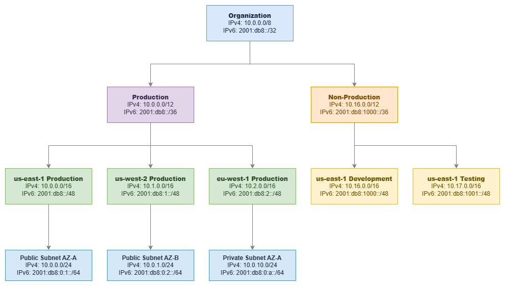

# CIDR 블록을 활용한 IP 주소 계획 {#ip-address-planning-with-cidr-blocks}

!!! info "사전 요구 사항"
    이 섹션은 [시작하기 전에](aws-prerequisites.md), [Amazon VPC](vpc.md), [리전 및 가용 영역](regions-azs.md)에 대한 이해를 전제로 합니다. AWS 네트워킹 기초가 처음이라면 해당 페이지를 먼저 검토하세요.

IP 주소 계획은 AWS 배포 초기에 내리는 결정 중 나중에 쉽게 변경할 수 없는 가장 중요한 결정입니다. 모든 VPC, 모든 서브넷, 모든 피어링 연결, 모든 하이브리드 링크, 모든 라우팅 테이블은 생성 시 선택한 CIDR 블록에 의해 제약을 받습니다. 올바르게 설계하면 네트워크가 수년간 깔끔하게 확장됩니다. 잘못 설계하면 그 수년을 주소 범위 겹침, 고갈된 주소 공간, 중복 범위로 인한 연결 제약을 해결하는 데 소비하게 됩니다.

CIDR(Classless Inter-Domain Routing) 표기법은 IP 주소 계획의 언어입니다. 기존의 클래스 기반 시스템(클래스 A, B, C)을 가변 길이 프리픽스로 대체하여 필요한 크기에 맞게 주소 공간을 정밀하게 분할할 수 있습니다. VPC, Transit Gateway, Cloud WAN, Direct Connect, VPN 등 모든 AWS 네트워킹 서비스는 CIDR을 사용합니다. 이를 완전히 이해하는 것은 선택이 아닌 필수입니다.

/// caption
계층적 CIDR 할당 — [Drawio 소스](../assets/foundation/cidr-hierarchy.drawio)
///

***핵심 인사이트:*** *조직 → 환경 → 리전 → VPC → 서브넷으로 이어지는 계층적 CIDR 할당은 단순히 깔끔한 정리 방식이 아닙니다. 이를 통해 경로 요약이 가능해지고, 방화벽 규칙이 단순해지며, 라우팅 테이블을 읽는 누구에게나 네트워크 토폴로지가 명확하게 전달됩니다.*

## CIDR 표기법 이해 {#understanding-cidr-notation}

CIDR 표기법은 IP 주소 범위를 `IP_ADDRESS/PREFIX_LENGTH` 형식으로 나타냅니다.

**예시**: `10.0.0.0/16`

* **IP 주소**: `10.0.0.0` — 네트워크 주소(범위의 시작점)
* **프리픽스 길이**: `/16` — 네트워크 부분에서 고정된 비트 수(나머지 비트는 호스트에 사용 가능)
* **주소 범위**: `10.0.0.0` ~ `10.0.255.255` (65,536개 주소)
* **서브넷 마스크**: `255.255.0.0`

프리픽스 길이는 블록에 포함된 주소 수를 결정합니다. `/16`은 2^(32-16) = 65,536개의 주소를 가집니다. 프리픽스가 짧을수록 주소가 많아지고, 길수록 주소가 줄어듭니다. 프리픽스를 1씩 늘릴 때마다 주소 공간은 절반으로 줄어듭니다.

### 일반적인 CIDR 블록 크기 {#common-cidr-block-sizes}

| CIDR | 주소 수 | 서브넷 내 사용 가능* | 일반적인 용도 |
| --- | --- | --- | --- |
| /16 | 65,536 | 65,531 | 엔터프라이즈 환경을 위한 대형 VPC, 서브넷 확장에 최대 여유 공간 제공 |
| /20 | 4,096 | 4,091 | 중형 VPC, 부서별 또는 단일 워크로드 VPC |
| /24 | 256 | 251 | 표준 서브넷 크기, 밀도와 관리 용이성의 균형 |
| /26 | 64 | 59 | 방화벽 엔드포인트, NAT 게이트웨이 또는 TGW 어태치먼트용 소형 서브넷 |
| /28 | 16 | 11 | 최소 VPC 또는 서브넷 크기, 특정 서비스 전용 |

*AWS는 각 서브넷에서 IP 주소 5개를 예약합니다(처음 4개와 마지막 1개).

### RFC 1918 프라이빗 주소 범위 {#rfc-1918-private-address-ranges}

VPC에 사용할 수 있는 프라이빗 IP 범위는 다음과 같습니다.

| 범위 | CIDR | 주소 수 | 권장 사항 |
| ------- | ------ | ----------- | ---------------- |
| 10.0.0.0 – 10.255.255.255 | 10.0.0.0/8 | 16,777,216 | **대부분의 조직에 권장.** 가장 큰 연속 공간으로, 계층적 할당을 깊이 있게 지원합니다. |
| 172.16.0.0 – 172.31.255.255 | 172.16.0.0/12 | 1,048,576 | 좋은 보조 범위. 온프레미스 네트워크에서 이미 사용 중인 경우가 많습니다. |
| 192.168.0.0 – 192.168.255.255 | 192.168.0.0/16 | 65,536 | 프로덕션 AWS 환경에서는 사용을 피하세요. 멀티 계정 환경에 비해 너무 작고, 가정용 네트워크 및 VPN 클라이언트에서 흔히 사용되어 IP 충돌 문제가 발생할 수 있습니다. |

### AWS 워크로드를 위한 추가 범위 {#additional-ranges-for-aws-workloads}

RFC 1918 외에도 AWS VPC는 다음 범위를 지원합니다.

* **100.64.0.0/10** (캐리어 등급 NAT 범위): VPC CNI 커스텀 네트워킹 기능을 사용하는 EKS 파드 네트워킹에 유용합니다. 파드는 이 범위에서 IP를 할당받아, 기본 RFC 1918 공간을 노드 및 기타 리소스에 보존할 수 있습니다. RFC 1918 공간이 소진된 경우에도 활용됩니다.
* **RFC 6815 공간** (`198.19.0.0/16`): 다른 범위가 소진되었을 때 VPC의 보조 CIDR로 사용할 수 있습니다.

***핵심 인사이트:*** *100.64.0.0/10 범위는 EKS 중심 환경을 위한 전략적 도구입니다. 단일 EKS 클러스터는 파드에 수천 개의 IP 주소를 소비할 수 있습니다. 커스텀 네트워킹을 통해 파드 네트워킹을 100.64.0.0/10에 할당하면, 기본 VPC CIDR을 노드, 로드 밸런서 및 기타 인프라에 사용할 수 있습니다. 신규 클러스터의 경우, IPv6 클러스터를 사용하면 IP 주소 부담을 다른 곳으로 옮기는 대신 근본적으로 해소할 수 있습니다. 파드가 IPv6 주소를 사용하므로 IPv4 공간을 전혀 소비하지 않습니다.*

## 모범 사례 {#best-practices}

### CIDR 할당 전략 {#cidr-allocation-strategy}

#### 경로 요약을 위한 연속적 할당 {#allocate-contiguously-for-route-summarization}

좋은 주소 계획의 가장 중요한 특성은 동일한 논리 그룹 내의 할당이 IPv4와 IPv6 모두에서 **연속적**이어야 한다는 것입니다. 조직의 전체 범위에서 시작하여 리전별 블록, 그리고 환경별 블록 순으로 하향식으로 할당하면 각 계층을 단일 프리픽스로 표현할 수 있습니다. us-east-1의 모든 프로덕션 VPC가 `10.0.0.0/12`와 `2001:db8::/40` 범위 안에 있다면, VPC별로 하나씩 광고하는 대신 주소 패밀리당 하나의 요약 경로만 온프레미스에 광고할 수 있습니다. 이것이 중요한 이유는 다음과 같습니다.

* 라우팅 테이블과 BGP 세션에는 유한한 [경로 용량](../observability/service-monitoring.md#monitor-quotas-before-you-hit-them)이 있으며, 온프레미스 라우터는 AWS 서비스보다 더 적은 경로를 지원할 수 있습니다.
* 경로 수가 적을수록 장애 발생 후 수렴 속도가 빨라집니다.
* 요약 경로는 방화벽 규칙을 단순화합니다. VPC별 항목 대신 하나의 규칙으로 전체 환경을 커버할 수 있습니다.
* 온프레미스로의 BGP 광고가 더 깔끔하고 안정적입니다.

**다중 리전 구성 예시** (AWS용 `10.0.0.0/9` 내 IPv4, BYOIP `/32` 내 IPv6):

| 리전 | IPv4 블록 | IPv6 블록 | 용도 |
| -------- | ----------- | ----------- | --------- |
| us-east-1 | `10.0.0.0/12` | `2001:db8::/40` | 기본 리전 |
| us-west-2 | `10.16.0.0/12` | `2001:db8:100::/40` | DR / 보조 리전 |
| eu-west-1 | `10.32.0.0/12` | `2001:db8:200::/40` | 유럽 워크로드 |
| ap-southeast-1 | `10.48.0.0/12` | `2001:db8:300::/40` | 아시아 태평양 워크로드 |
| 예약 | `10.64.0.0/10` | 나머지 `/32` | 향후 리전 |

각 IPv4 `/12`는 16개의 `/16` 또는 256개의 `/20` VPC를 수용합니다. IPv6 리전 풀은 다양한 서브넷 계층 구조에 맞는 VPC 할당을 지원하므로, IPv6에서의 계층 구조는 주소 부족이 아닌 경로 요약과 거버넌스를 위해 존재합니다. BYOIP 없이 공개적으로 라우팅 가능한 공간이 필요한 경우, IPAM 리전 풀에 프로비저닝된 Amazon 제공 연속 블록을 사용하면 조직 전체 프리픽스 없이도 동일한 리전별 구조를 구성할 수 있습니다. IPAM의 프라이빗 범위에 있는 프라이빗 IPv6 ULA 또는 GUA 범위는 내부 전용 주소 지정을 위한 조직 전체 계층 구조를 제공할 수 있습니다.

비연속적 할당은 두 주소 패밀리 모두에서 경로 요약을 불가능하게 만듭니다. IPv4에서는 팀별 번호 지정 방식, 예를 들어 프로덕션 VPC가 `10.0.0.0/16`과 `10.5.0.0/16`에 있고 그 사이에 개발 환경이 `10.1.0.0/16`에 있는 경우에 발생합니다. IPv6에서는 각 VPC가 IPAM 외부에서 Amazon 제공 CIDR을 요청할 때 발생합니다. 각 할당이 서로 무관하므로 모든 VPC가 개별적으로 광고되고 필터링됩니다.

***핵심 인사이트:*** *전체 주소 공간의 최소 50%를 향후 성장을 위해 예약하세요. 조직들은 3~5년 후에 필요한 VPC, 계정, 리전의 수를 지속적으로 과소평가합니다. 주소 공간은 무료이지만, 주소 공간이 부족해지면 그 대가는 결코 무료가 아닙니다.*

#### 기존 네트워크에 경로 요약 적용하기 {#retrofit-summarization-into-an-existing-network}

대부분의 대규모 네트워크는 계층적으로 할당되지 않았기 때문에, 모든 VPC 프리픽스가 Transit Gateway, AWS Cloud WAN, 그리고 온프레미스를 통해 개별적으로 전파됩니다. 이 문제는 늦게 나타납니다. 라우팅 테이블과 BGP 세션이 경로 한도에 근접하면, 팀들은 근본 원인이 주소 계획에 있음에도 불구하고 필터링 기능을 찾게 됩니다. 모든 것을 한 번에 재번호 지정할 수는 없습니다.

기존 VPC와 온프레미스 범위를 IPAM으로 가져와 이미 요약 가능한 블록 내에 있는 범위를 찾으세요. Cloud WAN [라우팅 정책](https://docs.aws.amazon.com/network-manager/latest/cloudwan/cloudwan-routing-policies.html), Transit Gateway와의 Direct Connect 게이트웨이 연결에 대한 [허용 프리픽스](https://docs.aws.amazon.com/directconnect/latest/UserGuide/allowed-to-prefixes.html), 또는 온프레미스 라우터를 통해 해당 블록을 지금 광고하세요. 각 요약을 광고하기 전에 전체 인벤토리와 대조하여 확인하세요. 다른 곳에 있는 범위를 포함하는 요약은 해당 트래픽을 끌어당겨 블랙홀로 만들 수 있습니다.

IPAM에서 리전별 요약 블록을 예약하고 모든 새 VPC를 해당 블록에서 할당하세요. 기존 워크로드는 재배포 시 새 블록의 [보조 CIDR](#use-secondary-cidrs-strategically-not-as-a-crutch)로 이전하세요. 아직 요약할 수 없는 경로는 [AWS 내 연결](../connectivity/within-aws.md)에서 설명하는 것처럼, 목적별 Transit Gateway 라우팅 테이블이나 Cloud WAN 세그먼트를 통해 해당 경로가 필요하지 않은 라우팅 도메인에서 제외하세요.

수렴 상태를 측정하기 위해 [경로 수를 할당량과 비교하여 추적](../observability/service-monitoring.md#monitor-quotas-before-you-hit-them)하세요.

***핵심 인사이트:*** *모든 새 VPC를 리전 블록에서 할당하여 경로 증가를 먼저 중단시킨 다음, 릴리스별로 기존 문제를 점진적으로 줄여나가세요.*

#### 프로덕션 VPC는 /16으로 시작하기 {#start-with-16-for-production-vpcs}

`/16`은 65,536개의 주소와 256개의 `/24` 서브넷을 생성할 수 있는 공간을 제공합니다. 다중 AZ 배포(3개 이상의 가용 영역 × 여러 서브넷 계층), EKS 파드 밀도, 향후 성장, 그리고 VPC CIDR을 생성 후 축소할 수 없다는 사실을 고려하면 이것이 과도해 보이지 않습니다. `/16`의 비용은 0입니다(VPC의 IP 주소는 Elastic IP나 퍼블릭 IPv4를 사용하기 전까지 무료입니다). 하지만 공간이 부족해지면 고통스러운 마이그레이션이 필요합니다.

규모에 대해 확신이 있는 비프로덕션 워크로드의 경우, `/20`(4,096개 주소)이 합리적인 선택입니다. 격리된 단일 목적 VPC(검사 VPC, Transit Gateway 어태치먼트 VPC)의 경우 `/24` 또는 `/28`로도 충분할 수 있습니다.

***핵심 인사이트:*** *VPC의 기본 CIDR 블록은 줄일 수 없습니다. 나중에 보조 CIDR을 추가할 수 있지만, 보조 CIDR에는 제한이 있습니다. 기존 CIDR과 겹칠 수 없고, 일부 서비스는 이를 완전히 지원하지 않으며, 운영 복잡성이 증가합니다. 기본 CIDR을 처음부터 올바르게 설정하는 것이 나중에 수정하는 것보다 항상 비용이 적게 듭니다.*

#### 연결 가능성이 있는 VPC 간 CIDR 블록 중복 금지 {#never-overlap-cidr-blocks-across-vpcs-you-might-connect}

연결할 가능성이 있는 VPC들이 절대 겹치지 않도록 할당을 설계하세요. 범위가 겹치면 VPC 피어링이 완전히 차단됩니다. VPC A가 `10.0.0.0/16`을 사용하고 VPC B가 `10.0.5.0/24`를 사용한다면, `10.0.5.0/24`가 `10.0.0.0/16` 내에 포함되기 때문에 이 두 VPC는 절대 피어링할 수 없습니다. 다른 경로로 중복을 우회할 수 있지만, 각각 비용, 운영 오버헤드, 또는 불필요한 주소 관리 부담을 추가합니다. 비중복 공간이 항상 깔끔한 해답입니다.

인수합병, 파트너 네트워크, 멀티클라우드 연결 등으로 인해 선택하지 않은 중복을 물려받은 경우, 몇 가지 복구 옵션이 있지만 어느 것도 무료가 아닙니다.

* **한쪽을 재번호 지정합니다.** 이 방법은 네이티브하고 변환 없는 IP 수준 라우팅을 복원하며, VPC 피어링을 사용해야 하는 경우 필수입니다. 또한 지원되지 않는 어태치먼트 유형이나 관리형 1:1 NAT가 변환하지 않는 겹치는 IPv6 고유 로컬 주소(ULA) 범위에 대한 영구적인 변환을 방지합니다. DNS, 애플리케이션 설정, 방화벽 규칙, 모니터링에 영향을 미치기 때문에 가장 침습적인 옵션입니다.
* **PrivateLink 또는 VPC Lattice를 통해 워크로드를 서비스로 노출합니다.** PrivateLink는 ENI를 사용하며 라우팅 가능한 연결이 필요하지 않습니다. VPC Lattice는 애플리케이션 계층에서 동작합니다. 변환된 주소 관리 없이 중복 문제가 보이지 않게 됩니다. 액세스가 전체 연결이 아닌 단방향 서비스 노출인 경우에 적합합니다.
* **[Transit Gateway 어태치먼트](https://docs.aws.amazon.com/vpc/latest/tgw/tgw-nat.html) 또는 [Cloud WAN 어태치먼트](https://docs.aws.amazon.com/network-manager/latest/cloudwan/cloudwan-nat.html)에서 관리형 정적 1:1 NAT로 변환합니다.** 이 방법은 겹치는 CIDR을 동일한 프리픽스 길이의 비겹치는 CIDR로 매핑하여, 재번호 지정 없이 양방향 IP 수준 라우팅을 제공합니다. 이 기능은 IPv4 전용이며 IPv6는 변환 없이 통과합니다. Transit Gateway는 AWS Cloud WAN 피어링 및 라우팅 테이블 어태치먼트, 네트워크 함수 어태치먼트, Client VPN 어태치먼트에서는 이를 지원하지 않습니다. Cloud WAN은 Transit Gateway 라우팅 테이블 어태치먼트 또는 터널리스 Connect 어태치먼트에서 지원하지 않습니다. 두 서비스 모두 동일한 VPC 어태치먼트에서 어플라이언스 모드와 함께 사용할 수 없습니다. [NAT 게이트웨이 시간당 요금 및 GB당 데이터 처리 요금](https://aws.amazon.com/vpc/pricing/)과 해당 표준 데이터 전송 요금이 발생합니다.

이는 아직 생성하지 않은 VPC를 포함하여 전체 조직에 적용됩니다. 할당 계획에서 향후 계정과 리전을 위한 주소 공간을 예약하세요.

#### 처음부터 하이브리드 연결 계획하기 {#plan-for-hybrid-connectivity-from-day-one}

AWS 환경이 온프레미스 네트워크, 기업 데이터 센터, 또는 다른 클라우드와 연결될 가능성이 조금이라도 있다면, 처음부터 모든 환경에 걸쳐 CIDR 할당을 조율해야 합니다. CIDR 중복으로 인한 하이브리드 연결 실패는 수정하는 데 가장 많은 비용이 드는 네트워킹 실수 중 하나입니다. 워크로드를 재번호 지정하거나(DNS, 애플리케이션 설정, 방화벽 규칙, 모니터링 시스템에 영향을 미침), 하이브리드 경로에 영구적인 주소 변환을 추가해야 하기 때문입니다. 후자는 NAT 요금, 주소 관리 부담, 로그 및 추적에서의 변환된 IP 문제를 야기합니다.

이를 위해 다음을 수행해야 합니다.

1. **AWS CIDR을 할당하기 전에 모든 온프레미스 IP 범위를 문서화하세요.** 지사, 파트너 네트워크, 인수한 회사 네트워크, 원격 액세스 VPN 풀을 포함하세요. 모르는 범위가 바로 중복될 범위입니다.
2. **온프레미스 할당과 절대 충돌하지 않는 비중복 공간을 AWS용으로 예약하세요.** 명확한 분리(예: 온프레미스는 `10.128.0.0/9`, AWS는 `10.0.0.0/9`)는 모호성을 제거합니다.
3. **온프레미스 주소 지정을 관리하는 네트워크 팀과 조율하세요.** 6개월 후에 데이터 센터 범위와 겹치는 것이 발견된 일방적인 AWS CIDR 결정은 VPC 재생성이나 하이브리드 경로의 영구적인 주소 변환을 강제합니다.
4. **VPN 클라이언트 풀을 고려하세요.** 원격 액세스 VPN 클라이언트는 AWS와 온프레미스 네트워크 모두와 겹치지 않는 IP 범위가 필요합니다. 많은 조직이 클라이언트 VPN 풀에 `172.16.0.0/12`를 사용합니다.
5. **인수합병을 계획하세요.** 회사가 다른 조직을 인수하면 그들의 네트워크 범위가 여러분의 문제가 됩니다. 일반적인 기업 할당과 충돌할 가능성이 낮은 공간을 예약하세요.

일반적인 패턴: `10.0.0.0/8`을 할당하되 온프레미스는 `10.128.0.0/9`를, AWS는 `10.0.0.0/9`를 사용합니다. 이렇게 하면 각 환경에 800만 개의 주소가 주어지며 중복 위험이 없습니다. 기존 온프레미스 할당이 `10.0.0.0/8` 전체에 분산되어 있는 조직의 경우, AWS에 `172.16.0.0/12`를 사용하거나 네트워크 팀과 협력하여 `10.x` 공간에서 사용되지 않는 부분을 찾으세요.

***핵심 인사이트:*** *가장 흔한 하이브리드 연결 실패는 Direct Connect 설정 오류나 BGP 잘못된 설정이 아닙니다. 워크로드가 이미 실행 중인 후에 발견되는 CIDR 중복입니다. AWS 할당을 하기 전에 "임시" 랩 네트워크와 잊혀진 지사를 포함한 모든 기존 범위를 문서화하세요.*

#### IPv4와 함께 IPv6 계획하기 {#plan-ipv6-alongside-ipv4}

AWS VPC에서 IPv6는 IPv4와 다르게 동작하므로 별도의 계획이 필요합니다.

* **VPC 수준**: 서브넷 계층 구조와 성장 요구 사항에 따라 IPv6 프리픽스 길이를 선택한 다음, IPAM 할당 규칙을 통해 이를 적용합니다. Amazon 제공 연속 블록, BYOIP, 또는 프라이빗 ULA/GUA 범위로 지원되는 리전 계층 구조에서 CIDR을 할당합니다.
* **서브넷 수준**: 워크로드 규모와 향후 세분화를 기반으로 VPC 할당 내에서 서브넷 프리픽스 길이를 선택합니다. IPv6 서브넷은 더 이상 단일 고정 크기로 제한되지 않습니다.
* **퍼블릭 IPv6에는 NAT 불필요**: 퍼블릭 GUA 주소는 전 세계적으로 고유하며, 이그레스 전용 인터넷 게이트웨이는 NAT 없이 아웃바운드 전용 인터넷 액세스를 제공합니다. 프라이빗 ULA/GUA 범위는 내부에 유지되며 인터넷 액세스를 위해 퍼블릭 주소를 가진 리소스를 통한 라우팅 경로가 필요합니다.
* **듀얼 스택**: 대부분의 조직은 적어도 전환 기간 동안 IPv6 전용이 아닌 듀얼 스택(IPv4 + IPv6)으로 운영합니다.
* **주소 고갈이 아닌 경로 요약이 주요 크기 결정 요소**: VPC와 서브넷 할당은 IPv4 방식의 주소 부족이 아닌 계층 구조와 성장을 위해 크기를 결정하고, 각 리전을 연속적으로 유지하여 경로를 요약할 수 있도록 합니다.

**IPv6 CIDR 소스 옵션:**

| 소스 | 사용 사례 | 고려 사항 |
| -------- | ---------- | --------------- |
| Amazon 제공 연속 블록이 있는 IPAM 리전 풀 | 다중 계정 환경의 기본값 | 리전당 하나의 요약 가능한 프리픽스. 블록은 리전 로케일이 있는 풀에 프로비저닝되므로 계층 구조는 조직 전체 풀이 아닌 리전에서 시작됩니다. |
| BYOIP(Bring Your Own IP) | 공개적으로 라우팅 가능한 조직 전체 IPv6 공간이 필요한 기업 | RIR 등록 및 ROA 필요. 주소 이식성 제공 |
| IPAM 프라이빗 범위의 프라이빗 IPv6 ULA 또는 GUA | 조직 전체 계층 구조가 필요한 내부 전용 네트워크 | 해당 범위는 AWS에서 인터넷으로 광고할 수 없습니다. 프라이빗 GUA 공간은 조직이 소유해야 합니다. |
| Amazon 제공 VPC별(IPAM 없음) | 단일 VPC, 샌드박스 | VPC 간 연속적이지 않으므로 할당을 요약할 수 없습니다. 연결 해제 시 주소가 변경됩니다. |

IPv6 계획은 한 가지 측면에서 IPv4보다 단순합니다. 주소 부족을 위한 크기 결정이 필요 없습니다. 복잡성은 연속 블록에서 할당하고 보안 그룹, NACL, 라우팅 테이블, 방화벽 규칙이 IPv6 트래픽 경로를 고려하도록 하는 데 있습니다. 퍼블릭 GUA 주소는 라우팅 및 보안 제어가 허용하는 경우에만 인터넷에 도달할 수 있습니다. 프라이빗 ULA/GUA 범위는 AWS에서 인터넷으로 광고할 수 없습니다.

**IPv6 계획 체크리스트:**

* IPv6 소스(Amazon 제공 연속 블록, BYOIP, 또는 프라이빗 ULA/GUA 범위)를 결정하고 VPC 생성 전에 리전 풀을 만드세요(나중에 변경하려면 연결 해제가 필요합니다).
* IPv6 규칙을 포함하도록 모든 보안 그룹을 업데이트하세요(IPv4 규칙은 IPv6 트래픽에 자동으로 적용되지 않습니다).
* 선택한 소스에 대한 IPv6 경로를 구성하세요. 퍼블릭 GUA는 인터넷 게이트웨이 또는 이그레스 전용 인터넷 게이트웨이를 사용하고, 프라이빗 ULA/GUA는 내부 또는 하이브리드 이그레스 경로를 사용합니다.
* NACL이 필요한 흐름에 대해 IPv6 트래픽을 허용하는지 확인하세요.
* 애플리케이션과 DNS 확인이 듀얼 스택을 올바르게 처리하는지 검증하세요.

#### 보조 CIDR은 전략적으로 사용하고 의존하지 않기 {#use-secondary-cidrs-strategically-not-as-a-crutch}

AWS는 VPC당 최대 5개의 IPv4 CIDR 블록(기본 1개 + 보조 4개)을 허용합니다. 보조 CIDR은 다음과 같은 경우에 유용합니다.

* **EKS 파드 네트워킹**: 파드 IP 공간을 위해 `100.64.0.0/16`을 보조 CIDR로 추가
* **인수합병**: 임시 주소 공간이 필요한 새로 인수한 회사의 워크로드 통합
* **점진적 마이그레이션**: 적절한 재번호 지정을 계획하는 동안 비중복 공간 추가

보조 CIDR은 적절한 초기 계획의 **대체재가 아닙니다**. 복잡성을 추가합니다. 라우팅 테이블에 각 CIDR에 대한 항목이 필요하고, 일부 서비스는 여러 CIDR을 일관성 없이 처리하며, 수백 개의 VPC에 걸쳐 여러 범위를 관리하는 운영 오버헤드가 누적됩니다.

***핵심 인사이트:*** *VPC에 보조 CIDR을 정기적으로 추가하고 있다면, 초기 할당이 너무 작았던 것입니다. 보조 CIDR은 설계 패턴이 아닌 비상 탈출구로 취급하세요.*

#### 일반적인 CIDR 계획 실수 피하기 {#avoid-common-cidr-planning-mistakes}

| 실수 | 문제점 | 예방 방법 |
| --------- | ------------- | ------------ |
| 프로덕션에 `192.168.0.0/16` 사용 | 홈 네트워크, VPN 클라이언트, 많은 온프레미스 환경과 중복됨 | AWS 프로덕션에는 `10.0.0.0/8` 사용 |
| "공간 절약"을 위해 `/24` VPC 할당 | 서브넷 용량이 빠르게 소진됨. 다중 AZ 또는 EKS를 위한 공간 없음 | 프로덕션은 기본적으로 `/16`, 비프로덕션은 최소 `/20` |
| 향후 리전을 위한 예약 공간 없음 | 확장 시 비연속적 할당 강제 | 전체 할당의 50% 이상 예약 |
| 온프레미스 범위 무시 | 발견된 중복으로 인해 하이브리드 경로에서 재번호 지정 또는 주소 변환 강제 | AWS 할당 전에 모든 기존 범위 문서화 |
| 조율 없는 팀별 할당 | 팀들이 독립적으로 겹치는 범위 선택 | IPAM 또는 공유 레지스트리를 통해 할당 중앙 집중화 |
| VPC CIDR을 변경 가능한 것으로 취급 | 기본 CIDR은 제거할 수 없으며 VPC 재생성 강제 | 처음부터 기본 CIDR을 영구적인 것으로 계획 |

## CIDR 계획과 다른 서비스의 결합 {#combining-cidr-planning-with-other-services}

CIDR 계획은 독립적인 활동이 아닙니다. CIDR 계획은 다른 모든 네트워킹 서비스를 직접적으로 가능하게 하거나 제약합니다. 주소 할당에 관한 결정은 이후에 채택하는 모든 연결 패턴에 파급 효과를 미칩니다. 잘 설계된 CIDR 계획은 Transit Gateway 라우팅 테이블을 깔끔하게 유지하고, Direct Connect BGP 광고를 단순하게 만들며, Cloud WAN 세그먼트 라우팅을 예측 가능하게 합니다. 반면 잘못 설계된 계획은 모든 계층에서 우회 방법을 강요합니다.

아래 표는 CIDR 결정이 주요 AWS 네트워킹 서비스와 어떻게 상호작용하는지 보여줍니다.

| 결합 | CIDR 계획이 제공하는 것 | 다른 서비스가 제공하는 것 |
| --- | --- | --- |
| **CIDR + IPAM** | 계층적 할당 체계, 크기 표준, 예약 범위 | 자동화된 할당 적용, 중복 방지, 컴플라이언스 감사, 멀티 계정 거버넌스 |
| **CIDR + Transit Gateway** | 라우팅 테이블을 공유할 수 있는 중복 없는 VPC 범위, 경로 요약을 위한 연속 블록 | 리전 허브 앤 스포크 라우팅, 중앙 집중식 이그레스, 공유 서비스 연결 |
| **CIDR + Direct Connect / 하이브리드** | 온프레미스와 절대 중복되지 않는 AWS 범위, BGP 광고를 위한 요약 가능한 블록 | 전용 프라이빗 연결, 예측 가능한 대역폭, 데이터 전송 비용 절감 |
| **CIDR + VPC 피어링** | 피어링된 VPC 간 엄격하게 중복 없는 범위(부분 중복 불허) | 대역폭 병목 없는 직접 저지연 연결 |
| **CIDR + Cloud WAN** | 세그먼트 경계에 맞춰 정렬된 리전별 연속 할당, [라우팅 정책을 위한 요약 가능한 프리픽스](../connectivity/within-aws.md#apply-routing-policies-at-network-boundaries) | 글로벌 정책 기반 네트워크, 세그먼트 격리, 서비스 삽입, 멀티 리전 라우팅 |
| **CIDR + EKS (VPC CNI)** | 파드 네트워킹을 위한 보조 CIDR(100.64.0.0/10), 노드에 맞게 크기가 조정된 기본 CIDR | VPC 네이티브 보안 그룹 및 네트워크 정책을 갖춘 파드 수준 네트워킹 |

가장 흔한 실패 패턴은 새로운 서비스를 도입하려 할 때 비로소 CIDR 제약을 발견하는 것입니다. 예를 들어, Transit Gateway를 배포했는데 서로 다른 계정의 두 VPC가 팀별로 독립적으로 할당한 결과 동일한 `10.0.0.0/16` 범위를 사용하고 있음을 발견하는 경우가 있습니다. 이 경우 네트워크가 통신하려면 IP를 재할당하거나 변환해야 합니다. 또는 Direct Connect를 구성했는데 AWS 범위가 아무도 문서화하지 않은 지사 서브넷과 중복된다는 사실을 뒤늦게 깨닫는 경우도 있습니다. 이는 Transit Gateway나 Direct Connect의 문제가 아니라, 배포 시점에 드러나는 CIDR 계획 문제입니다.

***핵심 인사이트:*** *이후에 도입하는 모든 네트워킹 서비스는 CIDR 계획의 혜택을 받거나 그 제약을 받게 됩니다. 적절한 할당 체계를 수립하는 데 투자하는 30분은 Transit Gateway, Direct Connect, Cloud WAN 배포 전반에 걸쳐 수백 시간의 우회 작업을 절약해 줍니다.*

## 서브넷 CIDR 계획 {#subnet-cidr-planning}

VPC 내에서 서브넷 설계는 워크로드의 격리 방식, 각 가용 영역에서 실행할 수 있는 리소스 수, 그리고 라우팅 테이블이 트래픽 흐름을 제어하는 방식을 결정합니다. 서브넷 CIDR은 VPC의 CIDR 블록에서 분할되며 서로 겹칠 수 없습니다.

모든 서브넷은 VPC CIDR의 연속된 일부를 사용합니다. AWS는 각 서브넷에서 5개의 주소를 예약합니다. 네트워크 주소, VPC 라우터(`.1`), DNS 서버(`.2`), 향후 사용을 위해 예약된 주소(`.3`), 그리고 브로드캐스트 주소(마지막 IP)입니다. 따라서 `/24` 서브넷은 256개가 아닌 251개의 사용 가능한 주소를 제공합니다.

**3개의 가용 영역에 걸친 `/16` VPC의 권장 서브넷 레이아웃:**

| 서브넷 계층 | AZ-A | AZ-B | AZ-C | 크기 | 용도 |
| ------------- | ------ | ------ | ------ | ------ | --------- |
| 퍼블릭 | 10.0.0.0/24 | 10.0.1.0/24 | 10.0.2.0/24 | /24 (251개 사용 가능) | 로드 밸런서, NAT 게이트웨이, 배스천 호스트 |
| 프라이빗 (애플리케이션) | 10.0.10.0/24 | 10.0.11.0/24 | 10.0.12.0/24 | /24 (251개 사용 가능) | 애플리케이션 서버, 컨테이너, Lambda |
| 프라이빗 (데이터) | 10.0.20.0/24 | 10.0.21.0/24 | 10.0.22.0/24 | /24 (251개 사용 가능) | RDS, ElastiCache, OpenSearch |
| 프라이빗 (예비) | 10.0.30.0/24 | 10.0.31.0/24 | 10.0.32.0/24 | /24 (251개 사용 가능) | 향후 사용, 추가 계층 |
| TGW/방화벽 | 10.0.250.0/28 | 10.0.250.16/28 | 10.0.250.32/28 | /28 (11개 사용 가능) | Transit Gateway ENI, 방화벽 엔드포인트 |

**서브넷 크기 지정 지침:**

* `/24`는 대부분의 워크로드에 적합한 표준 서브넷 크기입니다. 가용 영역당 251개의 사용 가능한 주소를 제공하며, 대부분의 애플리케이션 계층을 충분히 수용합니다.
* 파드가 기본 CIDR을 사용하는 경우 EKS 워커 노드 서브넷에는 `/20` 이상을 사용하세요(각 노드는 파드 용량에 비례하여 IP를 소비합니다).
* 소수의 ENI만 호스팅하는 인프라 서브넷(Transit Gateway 어태치먼트, Network Firewall 엔드포인트, NAT 게이트웨이)에는 `/28`을 사용하세요.
* 새로운 서브넷 계층을 번호 재지정 없이 삽입할 수 있도록 번호 체계에 간격을 두세요(위에서 `.2.0`에서 `.10.0`으로 건너뛰는 것을 참고하세요).

**서브넷 설계 원칙:**

* **가용 영역 간 일관성 유지**: 모든 가용 영역은 동일한 크기의 동일한 서브넷 계층을 가져야 합니다. 이를 통해 워크로드가 용량 차이 없이 가용 영역 간에 페일오버할 수 있습니다.
* **계층별 별도 라우팅 테이블**: 퍼블릭 서브넷은 인터넷 게이트웨이로 라우팅하고, 프라이빗 서브넷은 NAT를 통해 라우팅하거나 내부에 머뭅니다. 단일 라우팅 테이블에 계층을 혼합하면 보안 위험이 발생합니다.
* **최소 3개의 가용 영역 계획**: 2개로 시작하더라도 처음부터 3개의 가용 영역을 위한 서브넷 체계를 설계하세요. 미리 계획했다면 일관된 체계로 세 번째 가용 영역을 나중에 추가하는 것은 간단합니다.
* **인프라 서브넷을 위한 공간 예약**: Transit Gateway 어태치먼트, Network Firewall 엔드포인트, Gateway Load Balancer 엔드포인트는 각각 가용 영역당 하나의 서브넷이 필요합니다. `/28`만 있으면 되지만 모든 가용 영역에 존재해야 합니다.

***핵심 인사이트:*** *서브넷 체계의 번호 간격은 낭비되는 공간이 아니라 미래를 대비한 설계입니다. 처음 세 계층에 10.0.0.0/24, 10.0.1.0/24, 10.0.2.0/24를 사용하는 VPC는 그 사이에 새로운 계층을 삽입할 여지가 없습니다. 간격이 있는 체계(0, 10, 20, 30)를 사용하면 기존 서브넷을 방해하지 않고 5, 15, 25에 새로운 계층을 추가할 수 있습니다.*

## 문서 {#documentation}

*   :material-file-document: **VPC CIDR 블록**

    ---

    VPC CIDR 블록 구성, 제한 사항 및 지원 범위에 관한 공식 문서입니다.

    [:octicons-arrow-right-24: 문서](https://docs.aws.amazon.com/vpc/latest/userguide/vpc-cidr-blocks.html)

*   :material-file-document: **서브넷 크기 조정**

    ---

    서브넷 CIDR 블록의 작동 방식, 예약된 주소 및 크기 조정 시 고려 사항을 설명합니다.

    [:octicons-arrow-right-24: 문서](https://docs.aws.amazon.com/vpc/latest/userguide/configure-subnets.html#subnet-sizing)

*   :material-file-document: **서브넷 CIDR 예약**

    ---

    특정 서비스의 전용 사용과 같은 특수 목적을 위해 서브넷 CIDR 공간의 일부를 예약합니다.

    [:octicons-arrow-right-24: 문서](https://docs.aws.amazon.com/vpc/latest/userguide/subnet-cidr-reservation.html)

*   :material-book-open-variant: **확장 가능한 멀티 VPC 네트워크 구축**

    ---

    대규모 IP 주소 계획, 멀티 계정 전략 및 연결 패턴을 다루는 AWS 백서입니다.

    [:octicons-arrow-right-24: 백서](https://docs.aws.amazon.com/whitepapers/latest/building-scalable-secure-multi-vpc-network-infrastructure/welcome.html)

*   :material-post: **하이퍼스케일 VPC 네트워크 설계**

    ---

    대규모 CIDR 계획, 주소 공간 관리 및 성장 전략에 관한 블로그 게시물입니다.

    [:octicons-arrow-right-24: 블로그 게시물](https://aws.amazon.com/blogs/networking-and-content-delivery/designing-hyperscale-amazon-vpc-networks/)

*   :material-book-open-variant: **RFC 1918 - 프라이빗 주소 할당**

    ---

    VPC CIDR 계획에 사용되는 프라이빗 IPv4 주소 범위를 정의하는 기반 RFC입니다.

    [:octicons-arrow-right-24: RFC 1918](https://datatracker.ietf.org/doc/html/rfc1918)

---

## 관련 기반 주제 {#related-foundation-topics}

이 페이지에서는 CIDR 계획 원칙을 다룹니다. 관련 기반 주제는 다음을 참조하세요.

* **[Amazon VPC](vpc.md)** — VPC 설계 패턴, 멀티 AZ 아키텍처, 그리고 VPC 구조가 CIDR 계획을 기반으로 구축되는 방식
* **[서브넷](subnets.md)** — CIDR 할당 내의 서브넷 계층, 라우팅 테이블 설계, 네트워크 ACL
* **[AWS IPAM](ipam.md)** — CIDR 할당 자동화, 중복 방지, 조직 전반에 걸친 정책 적용
* **[리전 및 가용 영역](regions-azs.md)** — 리전 선택이 멀티 리전 CIDR 할당 전략에 미치는 영향
* **[AWS Organizations](organizations.md)** — CIDR 계층 구조가 반영해야 하는 계정 구조
